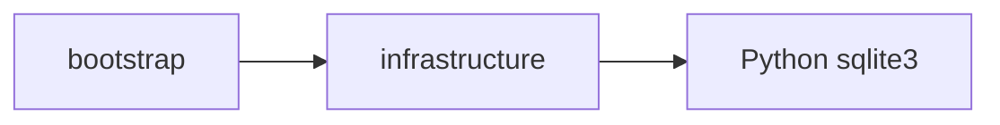

# 初期 PoC の依存境界

今回実装した境界は `tach.toml` で検査する。

- `bootstrap/probe.py`: 引数、JSON 出力、終了コード、具象依存の配線。
- `infrastructure/source/sqlite_probe.py`: SQLite の調査処理。
- `infrastructure` は他のプロジェクト層に依存しない。
- domain / application は業務モデル導入時に追加する。

今回の処理は汎用 SQLite の feasibility probe であり、録音を列挙する
SourceReader の実装ではない。将来の CLI は application use case に委譲し、
具象 adapter との配線のみ bootstrap が担当する。
