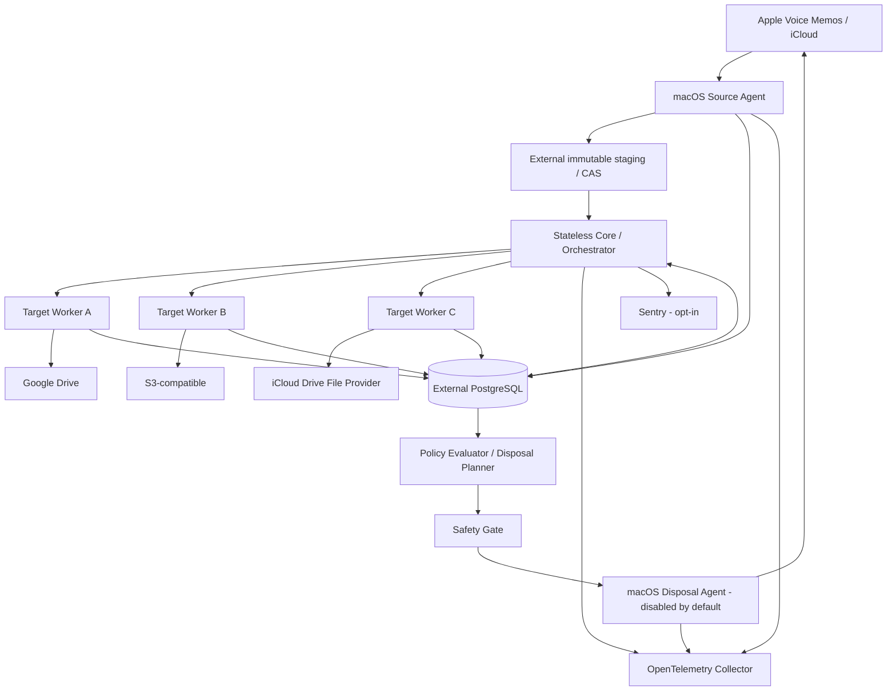

# Voice Memo Archiver — 要件定義書・基本設計書

- **文書 ID**: VMA-RD-BD-001
- **版**: 0.1.0（検討用ドラフト）
- **作成日**: 2026-10-16
- **対象**: Apple Voice Memos / iCloud 同期録音の保存・検証・オフロード
- **主たる実装言語**: Python（Core）、Swift 等（必要時の macOS Host Adapter）
- **ステータス**: [D] 暫定設計、[R] 確定要件、[P] PoC 待ち、[O] 未決事項

> **安全上の原則**: この文書は Apple Voice Memos の内部形式・自動削除 API の存在を保証しない。実機検証まで Source
> の削除操作は
> **無効** とする。音声が各クラウドに存在することと、編集履歴・文字起こし等を含む原本の完全な復元可能性は別の要件である。

## 1. エグゼクティブサマリー

本システムは、iCloud 同期された Voice Memos から取得可能な音声と付随情報をできる限り損失なく採取し、独立した複数の保存先に
**イミュータブルなバージョン付きアーカイブ**
として保存し、各保存先で完全性を検証する。条件付きで原本を削除する機能を持つが、安全ゲートを通過しない場合は絶対に削除しない。
各保存先の失敗は他の保存先の同期処理・成功状態を汚染しない。

### 1.1 前提と非目標

- [R] iPhone 上の Voice Memos が全録音をローカル保持する問題に対応し、iCloud
  の録音自体を安全に縮減できることを最終目標とする。アーカイブ後は音声を一般的な形式で再生可能とする。
- [R] 保存先は任意に追加・削除・無効化できる複数のクラウドストレージ（当初候補: Google Drive / iCloud Drive / S3
  互換）とする。
- [R] 複数保存先の「完全一致」とは、選択された同一の **論理 Revision**について各保存先が同じ内容ハッシュを持ち、その
  Revision に必要なアーティファクト群をすべて検証済みであることを指す。到達時刻までの強い分散トランザクションを保証するものではない。
- [D] 既存の Voice Memos アプリの内部 DB を書き換えない。iCloud/CloudKit の非公開 API
  を直接操作しない。これらの制約は破壊リスクを避けるためであり、調査
  PoC は読み取り専用で実施する。
- [D] アーカイブから Voice Memos への **完全な再インポート**（元の内部
  ID、編集可能な履歴、フォルダ、文字起こしと同期状態を復元）は初期スコープ外。代わりに通常の音声再生とメタデータ閲覧・エクスポートを必須とする。
- [D] macOS が停止していても iCloud Voice Memos に直接到達するポータブル API は、公開手段を確認できるまで存在を仮定しない。

### 1.2 用語と命名

- **名称**: `Source` / `SourceAccount`
   - **定義**: Voice Memos の論理的取得元とアカウントの範囲
   - **理由**: 複数 Apple Account の誤混同を防ぐ
- **名称**: `Recording`
   - **定義**: 取得元の永続 ID を持つ論理録音
   - **理由**: リネーム後も同一論理録音
- **名称**: `Revision`
   - **定義**: Recording の観測した不変スナップショット
   - **理由**: 音声編集・メタデータ変更を履歴化
- **名称**: `Artifact`
   - **定義**: 音声、層別トラック、文字起こし、raw 取得物等
   - **理由**: 種類別に検証可能
- **名称**: `Manifest`
   - **定義**: Revision に属する Artifact とハッシュの正規化された宣言
   - **理由**: 可搬性・検証・復元
- **名称**: `StorageBackend`
   - **定義**: Google Drive / S3 / Filesystem 等の **実装型**
   - **理由**: `Backend` は実装方式に限定
- **名称**: **`ArchiveTarget`**
   - **定義**: Backend の資格情報・root・ポリシーを持つ **保存先インスタンス**
   - **理由**: Profile より意味が明確
- **名称**: `Replica`
   - **定義**: (ArchiveTarget, Revision) の保存・検証状態
   - **理由**: 同じ Backend に Target は複数可
- **名称**: `Run`
   - **定義**: 観測・処理の一回の実行
   - **理由**: ランダム `run_id` を使用
- **名称**: `LogicalOperation`
   - **定義**: 対象と目的から決まる冪等な操作
   - **理由**: `operation_key` を安定計算
- **名称**: `Disposal`
   - **定義**: iCloud Voice Memos 上の原本削除
   - **理由**: 端末キャッシュの追い出しと区別
- **名称**: `Capability`
   - **定義**: Source / Target が証明可能に提供する機能
   - **理由**: 完全性水準を明示

**採用**: `ArchiveTarget`（設定インスタンス）、`StorageBackend`（実装）、`Replica`（保存状態）。`Profile`
は GUI 上の任意の表示名としてのみ許容。

## 2. ソース仕様と検証の前提

### 2.1 Apple 公開情報で確認できる事実

1. 同一 Apple Account で Voice Memos の iCloud 同期をオンにすると、録音が Mac / iPhone / iPad
   等に同期される。[S1]
1. Mac 版 Voice Memos は個々の録音を Finder にドラッグして保存できる。[S2]
1. Voice Memos では録音のリネーム、上書き編集、トリミング、重ね録り等が可能で、上書き保存は元の録音内容を変える。[S3]
1. 対応環境では音声の文字起こしが利用でき、アプリ上でテキストをコピーできる。地域・端末条件がある。[S4]
1. Mac で録音を完全削除すると、同一 Apple Account の他デバイスからも削除される。[S5]
1. 本調査では、Voice Memos 全項目への列挙・raw メタデータ取得・個別 ID 指定削除を一体的に提供する **公開・サポート対象
   API は確認できなかった**。これは「不可能」の断定ではない。[S1–S5]

### 2.2 SourceAdapter の候補と採否 [P]

- **方式**: A: macOS の読み取り専用スナップショット / private store 解析
   - **音声取得**: 高い可能性・要 PoC
   - **メタデータ**: 最も豊富な可能性
   - **削除**: 不採用
   - **リスク/工数**: OS 更新で形式変更、TCC、Cloud 未取得
   - **方針**: **第一候補の収集アダプター**、読み取りのみ
- **方式**: B: Voice Memos の公式 UI 書き出し
   - **音声取得**: 確認済み
   - **メタデータ**: 書き出しで失う可能性
   - **削除**: GUI 操作は要検証
   - **リスク/工数**: 多数件の自動化が脆弱
   - **方針**: **フォールバック**
- **方式**: C: 公開 Apple API / App Intents / Shortcuts
   - **音声取得**: 未確認
   - **メタデータ**: 未確認
   - **削除**: 未確認
   - **リスク/工数**: 機能自体が不足する可能性
   - **方針**: 先行 PoC、機能が揃えば採用
- **方式**: D: iOS 独自アプリから他アプリの録音を直接列挙
   - **音声取得**: 権限・sandbox により困難
   - **メタデータ**: 同左
   - **削除**: 同左
   - **リスク/工数**: 高
   - **方針**: 対象外
- **方式**: E: 非公開 CloudKit エンドポイント逆解析
   - **音声取得**: 未確認
   - **メタデータ**: 未確認
   - **削除**: 未確認
   - **リスク/工数**: 認証・規約・破壊的変更リスク大
   - **方針**: **初期実装から除外**

**重要**: 内部 DB のパス・テーブル名・同期状態・ファイル形式を固定仕様とみなさない。macOS 27 実機上で、DB 複製方法（SQLite
backup API、WAL 整合性等）、録音ファイルの完全取得、Cloud 側からの materialize、コレクション ID
の安定性を検証する。macOS 版の
DB と Cloud が異なる論理状態を保持する場合を想定する。

### 2.3 メタデータ・サルベージ目録

- **分類**: Identity
   - **候補フィールド / 対象**: source account の匿名識別子、永続 recording ID、親子・複製関係
   - **取得規則**: raw 値と型を保持
   - **完全性への組入れ**: 必須
- **分類**: 音声
   - **候補フィールド / 対象**: 原本バイト、コンテナ、codec、track/channel、サンプルレート、duration、bitrate、
      size
   - **取得規則**: **再エンコードしない**。各トラックを保持
   - **完全性への組入れ**: 必須
- **分類**: Layer
   - **候補フィールド / 対象**: 層別音声、mix、トラック順・関連性
   - **取得規則**: 存在時は全 Artifact 収集
   - **完全性への組入れ**: 存在するなら必須
- **分類**: 日付
   - **候補フィールド / 対象**: 録音開始日時、終了、更新、作成、時刻帯、精度
   - **取得規則**: ISO 8601 UTC + 元の生値
   - **完全性への組入れ**: 観測できれば必須
- **分類**: 人間可読
   - **候補フィールド / 対象**: title、folder、並び順、名称変更、位置に基づく名称
   - **取得規則**: raw と正規化値
   - **完全性への組入れ**: 観測できれば必須
- **分類**: 編集
   - **候補フィールド / 対象**: trim、replacement、enhancement、version history、edit points
   - **取得規則**: 保存可能な記述/実体を保持
   - **完全性への組入れ**: 観測できれば必須
- **分類**: Transcript
   - **候補フィールド / 対象**: 全文、言語、time-alignment、speech segments、話者
   - **取得規則**: raw と UTF-8 正規化を区別
   - **完全性への組入れ**: 観測できれば必須
- **分類**: 付帯情報
   - **候補フィールド / 対象**: waveform、tags、favorites、deletion flag、sync/Cloud status
   - **取得規則**: raw と既知フィールド
   - **完全性への組入れ**: 観測できれば必須
- **分類**: ファイル属性
   - **候補フィールド / 対象**: original file name、MIME、path（機微情報を縮減）、birthtime、xattrs
   - **取得規則**: 利用可能なら保存
   - **完全性への組入れ**: サポート範囲内で必須
- **分類**: 未知のキー
   - **候補フィールド / 対象**: raw DB record / opaque blob / 対応 sidecar / source schema
      fingerprint
   - **取得規則**: 解釈不能でも **type / encoding / bytes** を保管
   - **完全性への組入れ**: 取得可能なら必須
- **分類**: 機能可否
   - **候補フィールド / 対象**: 取得不可能・権限不足・未実装・観測対象にない
   - **取得規則**: 理由と検査日時を明示
   - **完全性への組入れ**: 完全性判定上必須

- [R] `missing`（本来あるが取得失敗）、`unsupported`（収集手段にない）、`not_applicable`（当該録音に存在しない）、
  `unknown`
  （存在自体未判定）を区別する。
- [R] メタデータを単純な JSON に型消失変換しない。raw 値のバイト列・型・解釈バージョンを保存し、normalized view は派生物とする。
- [R] 可逆性を示せない加工（転写訂正、音声正規化、音声再圧縮、位置情報の省略）は *source artifact*
  を置換しない。派生物として別キーに格納する。
- [R] 非関連録音の秘密情報や別アカウントの全 DB を無条件にクラウド送信しない。DB
  全体のバックアップをする場合は明示同意を要する別レベルの保全モードとし、暗号化・分離する。
- [P] unknown key のシリアライズ・秘匿フィールド含有・ライセンス上の取扱いを実機確認する。

### 2.4 完全性に関する明示的な限界

「取得元に本当に存在する全情報」を未知の private store から数学的に証明することはできない。このため完全性を二軸に分離する。

- **Acquisition completeness**: `COMPLETE / PARTIAL / UNKNOWN / UNSUPPORTED`。
  実機で検証した `CapabilityManifest`
  と比較し、必須フィールド・raw 保全・取得スナップショットの整合性を評価する。
- **Replica integrity**:
  `VERIFIED_BYTES` / `VERIFIED_PROVIDER_CHECKSUM` /
  `PRESENT_UNVERIFIED` / `FAILED` / `MISSING`。対象
  Target に書いた Artifact 全体について照合する。
- **Restorability**:
  `PLAYABLE / PORTABLE_METADATA / SOURCE_RECONSTRUCTABLE / UNTESTED`。`PLAYABLE`
  は元アプリ状態の復元を意味しない。

`FULLY_ARCHIVED` はバージョンと Target ごとの結果であり、`acquisition == COMPLETE`、必須 Artifact
が揃うこと、各 Artifact
の転送先バイトが元のバイトと照合済み、Manifest を検証済み、Target から読み出せること、を必要とする。
元アプリの私有編集履歴等を完全再現できない場合は
`SOURCE_RECONSTRUCTABLE` を名乗らない。

## 3. 機能要件

### 3.1 要件一覧と検収条件

- **ID**: FR-001
   - **優先度**: Must
   - **要件**: Source 列挙と録音 ID の安定識別
   - **検収条件**: 位置や title が変わっても同じ ID、ID 無しは隔離
- **ID**: FR-002
   - **優先度**: Must
   - **要件**: 音声原本を再圧縮せず保存
   - **検収条件**: source と staging の SHA-256・size が一致
- **ID**: FR-003
   - **優先度**: Must
   - **要件**: 保存可能なメタデータ・opaque data を全採取
   - **検収条件**: Inventory の各フィールドに取得結果または理由
- **ID**: FR-004
   - **優先度**: Must
   - **要件**: 録音の追記・上書き・タイトル変更を Revision 化
   - **検収条件**: 旧 Revision は不変で新 Revision が追加
- **ID**: FR-005
   - **優先度**: Must
   - **要件**: 任意の ArchiveTarget を設定し増減可能
   - **検収条件**: 1 Backend 型の複数 Target も可
- **ID**: FR-006
   - **優先度**: Must
   - **要件**: Target を独立して同期
   - **検収条件**: A 障害時 B の処理は継続、A の再試行は A のみ
- **ID**: FR-007
   - **優先度**: Must
   - **要件**: Target ごとの完了・検証記録
   - **検収条件**: (target_id, revision_id) 単位で証明
- **ID**: FR-008
   - **優先度**: Must
   - **要件**: 内容アドレス保存、manifest と revision 整合
   - **検収条件**: 暫定オブジェクトは committed に見えない
- **ID**: FR-009
   - **優先度**: Must
   - **要件**: 条件式による原本削除可否評価
   - **検収条件**: AND/OR/NOT/日数比較、未知値では不許可
- **ID**: FR-010
   - **優先度**: Must
   - **要件**: Source 削除の二段階保護
   - **検収条件**: dry-run / 再確認 / 監査 / 停止可能 / デフォルト無効
- **ID**: FR-011
   - **優先度**: Must
   - **要件**: 冪等同期・再実行・再開
   - **検収条件**: 同じ operation key で論理重複なし
- **ID**: FR-012
   - **優先度**: Must
   - **要件**: restore/export と通常再生
   - **検収条件**: 全必要ファイルと manifest を別端末で取り出せる
- **ID**: FR-013
   - **優先度**: Must
   - **要件**: drift の検出・再修復
   - **検収条件**: 不正 Target のみ隔離・復元
- **ID**: FR-014
   - **優先度**: Must
   - **要件**: telemetry / error reporting
   - **検収条件**: OTel traces/metrics、Sentry opt-in
- **ID**: FR-015
   - **優先度**: Must
   - **要件**: 秘密情報・音声内容を observability に流さない
   - **検収条件**: テストで機微データなし
- **ID**: FR-016
   - **優先度**: Must
   - **要件**: スケジュール・差分スキャン・手動再実行
   - **検収条件**: 同一時刻の重複 Run でも収束
- **ID**: FR-017
   - **優先度**: Must
   - **要件**: 転送中断・制限・認証切れの復帰
   - **検収条件**: 状態保存、遅延再試行、Target 独立
- **ID**: FR-018
   - **優先度**: Must
   - **要件**: 削除前の独立した Source 再読込
   - **検収条件**: 対象 ID/Revision/同期安定性を確認
- **ID**: FR-019
   - **優先度**: Must
   - **要件**: 削除不能・情報不明時 fail-closed
   - **検収条件**: UNKNOWN / PARTIAL / 競合 / 直近変更時は不実施
- **ID**: FR-020
   - **優先度**: Should
   - **要件**: 監査可能な CLI / 管理ビュー
   - **検収条件**: reason tree と保管済み proof を参照可
- **ID**: FR-021
   - **優先度**: Should
   - **要件**: ストレージ暗号化（外部鍵の選択）
   - **検収条件**: 鍵・復号手順と restore drill
- **ID**: FR-022
   - **優先度**: Should
   - **要件**: ソース削除直後の伝播確認
   - **検収条件**: 既削除 / 未削除を照会して再試行制御
- **ID**: FR-023
   - **優先度**: Could
   - **要件**: プレビュー再生・検索・transcript index
   - **検収条件**: 音声非保有の端末から閲覧可
- **ID**: FR-024
   - **優先度**: Could
   - **要件**: グラフィカル管理 UI / iOS client
   - **検収条件**: Core の公開インタフェースを通じて実装

### 3.2 同期セマンティクスと障害隔離

1. 各 Target は `desired_revision_id` に対して別々の `ReplicaState`、`attempt_count`、
   `last_error`、`verification_at`、
   `retry_after`、`lease` を持つ。
1. A のタイムアウトは **A に属する状態のみ**失敗にする。B の転送・検証は継続する。共有 source の読み取りエラーや staging
   障害は入力基盤の共通障害であり、新しい処理全体を停止し得るが、過去の B の成功を取り消さない。
1. 削除条件式が A と B の結果を参照することは許す。これは **ポリシー上の依存** であり、実行上のエラー伝播ではない。
1. Target 自体の認証失効・quota・レート制限は Target 単位で circuit breaker / backoff とする。
1. 変更履歴は append-only。削除や障害によって成功済みの別 Target の Revision と Receipt を変更しない。
1. 物理レプリカに drift が発生した場合はその Replica だけ `DEGRADED` にし、健全な Target から **検証済みデータ**
   を使って修復できる。ただし暗黙に他 Target を権威 source にしない。
1. 新 Target の追加時は既存 Revision を backfill する。削除条件式で参照されている Target
   の無効化・削除は、そのポリシーの再評価または管理者承認を必要とする。
1. ある Target が後から復帰したとき、現在の Archive Set だけでなく過去の残件を同期する（ポリシー・retention
   による明示的な除外を除く）。

### 3.3 削除ポリシー言語

- `recording_age_days >= n`：録音開始時刻から UTC の現在時刻までの経過、`n >= 0`。Source
  時刻に不確実性・欠損がある場合
  UNKNOWN。
- `archived("target-name")`：当該 **Source の current Revision** が Target で
  `FULLY_ARCHIVED` かつ検証 fresh。Target は
  immutable `target_id` で解決し、表示名変更の影響なし。
- `NOT` は三値論理（TRUE / FALSE / UNKNOWN）の否定。`NOT UNKNOWN = UNKNOWN` とする。`AND` `OR`
  は Kleene の三値論理。
  `UNKNOWN` の最終結果は削除不許可。
- 型付き AST と厳密 schema で解析し、文字列の `eval()` 等は使用しない。参照しない/削除済み Target は暗黙に TRUE
  にしない。
- `archived` は `not archived` でも論理上評価可能だが、 **保存確認なしの削除は禁止する**「独立安全ゲート」を優先させる。

```yaml
# 非実行の設計例。実際の source/target ID は設定ストアで解決する。
disposal:
  enabled: false
  mode: dry_run
  min_verified_targets: 2
  min_age_after_last_change: 7d
  verification_max_age: 24h
  policy:
    all:
      - recording_age_at_least: 30d
      - any:
          - all:
              - archived: google-primary
              - archived: s3-secondary
          - archived: designated-cold-store
```

**注**: 上例の `OR` により 1 Target のみ true のケースでも、`min_verified_targets: 2`
と最小独立障害ドメイン数を満たさなければ削除しない。
`n` 日は録音日時、`min_age_after_last_change` は最終観測変更日時とする。真偽は `reason` ツリー付きで記録する。

**不変の安全ゲート**: `deletion_enabled` / 有効な consent / source ID 一意 / original が現在存在 /
同期安定 / 正しい
current Revision / 取得完全 / 必須フィールド完全 / 直近変更なし / dry-run 検証 / fresh な Target 実証 /
独立ドメイン数 /
保存容量健全 / 保全中でない / source adapter が安全な削除に対応 / 強制停止フラグなし。どれか不成立なら `BLOCKED`
。ユーザー設定はこの基礎ゲートを無効化できない。

**検証 freshness**: デフォルト 24 時間（設定可能）。長期アーカイブで検証期限切れなら、再検証後に削除判定。
前回正常だったことのみをもって削除可としない。Source
と同じ実体の別同期フォルダを「独立した複製」とカウントしない。`independent_failure_domain` を Target に設定する。

### 3.4 削除の二相ワークフロー

1. **Plan**: Source を再発見・最新 Revision 再採取。録音日時、内容 hash、メタデータ等の完全性を再検証。
1. **Evaluate**: 条件 AST と安全ゲートを評価し、`DisposalPlan`（recording ID、expected
   revision、proof、expiry、policy
   digest）を DB に一意作成。既定は dry-run。
1. **Quarantine**: 可能であれば明示されたレビュー期間を設ける。収集対象からは消さない。
1. **Approve**: 自動承認は PoC で安全性を確認した後のみ許可。初期運用は録音ごと、または署名した batch approval。
1. **Execute**: SourceAdapter が ID と expected revision を再照合したうえで単回の削除要求。UI
   スクリプト方式で対象 ID
   を厳密に結びつけられない場合は自動削除不可。
1. **Reconcile**: 応答タイムアウト時に重複削除要求を闇雲に送信せず、Source の当該 ID が recently-deleted /
   absent / alive
   のいずれかを観測。状態不明なら `UNKNOWN`, manual review。
1. **Audit**: plan、評価根拠、approval actor、adapter、request ID、時刻、結果を外部状態ストアに
   append-only 記録。各 Replica
   の既存データを自動削除しない。

`Recently Deleted` への通常削除と「完全消去」は別操作。初期版は永続消去を実装しない。Voice Memos
の削除保持日数の設定により自動消去され得る点を運用で警告する。[S5]

### 3.5 restore / browse

- `list`, `inspect`, `export`, `verify`, `restore-files`, `plan-disposal`,
  `disposal-status` の CLI を提供する。
- ArchiveTarget を指定して独立に復元できること。復元は暗号化の場合は鍵を必要とする。
- `export` は元バイトそのものと metadata/manifest をローカルへ書き出し、音声は一般の再生アプリで再生可能であること。特殊な
  codec/layer には必要なデコード情報を表示する。
- 元 Voice Memos へ再インポートした時に同じ DB 状態になることは保証しない。これを GUI で明示する。
- transcript の検索を行う場合は明示 opt-in。既定で全文検索の外部 SaaS 送信を行わない。

## 4. 非機能要件と SLO

- **ID**: NFR-001
   - **要件**: 安全性
   - **初期目標・方法**: 意図しない Source 削除 0。疑義があれば停止
- **ID**: NFR-002
   - **要件**: 正確性
   - **初期目標・方法**: 検証対象バイトに対して SHA-256、size、Manifest canonical hash を照合
- **ID**: NFR-003
   - **要件**: 故障分離
   - **初期目標・方法**: 1 Target 障害が他 Target のジョブ失敗に波及しないことを故障注入で証明
- **ID**: NFR-004
   - **要件**: 可用性
   - **初期目標・方法**: Source の Mac 停止中は取得・削除を待機、既保存物の検証は継続可
- **ID**: NFR-005
   - **要件**: 運用性
   - **初期目標・方法**: Target 別滞留、転送量、検証齢、障害原因、削除候補を可視化
- **ID**: NFR-006
   - **要件**: セキュリティ
   - **初期目標・方法**: 最小権限、secret 外部管理、HTTPS/TLS、監査、PII を送信しない
- **ID**: NFR-007
   - **要件**: 可搬性
   - **初期目標・方法**: Core の Linux/arm64, Linux/amd64 OCI image。macOS host agent は別
- **ID**: NFR-008
   - **要件**: ステートレス
   - **初期目標・方法**: Worker の再起動・破棄後に DB と blob store から再開
- **ID**: NFR-009
   - **要件**: 一貫性
   - **初期目標・方法**: 実行の重複でも 1 論理 operation/Revision として収束
- **ID**: NFR-010
   - **要件**: 監査
   - **初期目標・方法**: 「なぜ削除されなかった/された」を reason tree と proof で再現
- **ID**: NFR-011
   - **要件**: メンテナンス
   - **初期目標・方法**: OS バージョンの capability probe に失敗したら採取・削除を停止
- **ID**: NFR-012
   - **要件**: 計算資源
   - **初期目標・方法**: streaming/hash、転送帯域と並列数を制限。大容量録音で全量 RAM 読込しない
- **ID**: NFR-013
   - **要件**: 再現性
   - **初期目標・方法**: ロックファイル、image digest、DB migration version、schema version を固定
- **ID**: NFR-014
   - **要件**: 応答
   - **初期目標・方法**: 定期スキャン間隔・RPO は設定値。初期値は 1 時間（提案）
- **ID**: NFR-015
   - **要件**: リカバリ
   - **初期目標・方法**: 定期 restore drill、破損 Target の修復、DB の別系統バックアップ

**SLO 候補（未承認）**: Source / ネットワークが利用できている期間に、新 Revision の 99% を 24 時間以内に少なくとも 1
Target
へ検証済みとする。全 Target 収束は各サービスの障害・quota に依存するため無条件の上限時間を保証しない。
失敗率・復旧時間・容量・単位費用を実測で決定する。

## 5. アーキテクチャ

### 5.1 論理構成



- **Source Agent**: macOS を要する処理、スナップショット・読み取り・安定 ID の取得。UI automation 等の OS
  依存はここに閉じる。Swift
  の native helper が本当に必要かは PoC で判定する。
- **Core**: domain / application / port と汎用 adapter。Python + CLI、CI
  の主対象。Docker/OCI 運用可能。
- **Target Worker**: Target ごとに状態、lease、retry、rate limit を持つ。
  実プロセスは共通でも論理分離を保証する。
- **Disposal Agent**: Source に対する唯一の書込権限。読み取り agent とは別プロセス/権限/認証スコープが望ましい。
- **External DB**: 制御プレーン状態の唯一の権威。PostgreSQL 推奨。データプレーンの実体は CAS/Target に保持。
- **External Staging**: 大容量 Blob の一時保管用、Worker を stateless にする。Source を削除するまで
  staging が利用できなくても、検証済み
  Target の状態は残る。

### 5.2 Core の境界と依存方向

```text
src/voice_memo_archiver/
  domain/
    models/
      identifiers.py             identifiers の VO + colocated test
      recording.py               Recording, Revision, Artifact
      integrity.py               hashes, completeness, predicates
      policy.py                  3-value AST + reason tree
      state_machine.py           Replica / Disposal transitions
      test_identifiers.py
      test_recording.py
      test_integrity.py
      test_policy.py
      test_state_machine.py
  application/
    ports/
      source.py                SourceReader / SourceDisposer
      storage.py               ArchiveStoragePort
      repository.py            StateRepository / Transaction
      staging.py               StagingStore
      clock.py                 Clock / ID generator
      telemetry.py             TelemetryPort
    use_cases/
      observe_source.py
      capture_revision.py
      sync_target.py
      verify_replica.py
      repair_replica.py
      plan_disposal.py
      execute_disposal.py
      restore.py
      # 各ユースケースの test_*.py を同居
  infrastructure/
    source/
      macos/
    storage/
      s3/
      google_drive/
      fileprovider/
    repository/
      sqlalchemy/
      staging/
    telemetry/
  interfaces/
    cli/
    worker/
    agent_protocol/
  bootstrap/
    container.py               composition root / DI wiring
  config/
    schema.py
tests/
  integration/
  contract/
  e2e/
  fixtures/
docs/
  REQUIREMENTS.md
  DESIGN.md
  ADR/
```

- `domain` は I/O や HTTP、ORM、SDK、環境変数、timezone dependent clock、logger 初期化に依存しない。
- `application` は port と domain にのみ依存。`infrastructure` が port を実装する。`interfaces`
  は use case 呼び出しのみ。
  `bootstrap` に具象依存の配線を集中。
- `tach` による許可依存を定義し、独立層間の import を違反として CI で fail にする。
- VO は意味・不変条件を持つフィールドに適用（`RecordingId`, `RevisionId`, `ArtifactDigest`,
  `TargetId`, `Timestamp`,
  `Duration`, `StorageKey`）。すべての `str`/`int`/`float` を無差別に包むことは YAGNI に反する。
- Entity は VO の集合を基礎とし、ライフサイクルと不変条件を担当。DB モデルを Domain に露出させない。`Clock`,
  `IdFactory`,
  `Hashing` は injected にして決定論的テスト可能とする。

### 5.3 Ports（概念インターフェース）

```python
from collections.abc import AsyncIterator
from typing import Protocol


class SourceReader(Protocol):
    async def inventory(self) -> "SourceInventory": ...

    async def observe(
            self, recording_id: "RecordingId"
    ) -> "SourceSnapshot": ...

    def stream_artifact(
            self, ref: "SourceArtifactRef"
    ) -> AsyncIterator[bytes]: ...


class ArchiveStoragePort(Protocol):
    async def put_immutable(
            self,
            key: "StorageKey",
            payload: "ByteStream",
            expected: "Digest",
    ) -> "ObjectReceipt": ...

    async def stat(self, key: "StorageKey") -> "ObjectMetadata | None": ...

    def read(self, key: "StorageKey") -> AsyncIterator[bytes]: ...

    async def publish_manifest(
            self,
            key: "StorageKey",
            payload: bytes,
            precondition: "WritePrecondition",
    ) -> "ObjectReceipt": ...


class SourceDisposer(Protocol):
    async def inspect_current(
            self, recording_id: "RecordingId"
    ) -> "SourceState": ...

    async def dispose(
            self, plan: "ApprovedDisposalPlan"
    ) -> "DisposalResult": ...
```

上記は **設計用の型概念**であり、依存型の前方参照、非同期 stream、例外型等は実装段階で厳密定義する。`ArchiveStoragePort`
は高レベルの `upload_atomic()` を約束せず、capability に応じた二相公開と conditional-write を
`StorageCapability` で表す。提供
API が原子的 rename を持たない Target でも Manifest 公開を論理的 commit point にする。

### 5.4 Port の capability negotiated features

`supports_read_back`, `supports_strong_checksum`, `supports_conditional_create`,
`supports_object_versioning`,
`supports_resumable_upload`, `supports_remote_presence_proof`,
`supports_delete`, `supports_encryption`,
`supports_low_cost_cold_storage`, `consistency_model` を Target ごとに
probe/declared とし、変更検出でキャッシュを破棄。必須
capability がない Target について `FULLY_ARCHIVED` を偽にするか、承認された低い保証レベルで運用する。能力が不明な
Target
は削除根拠に採用しない。

### 5.5 Docker / 実行基盤

- **構成**: Core / Target / Policy Worker
   - **ランタイム**: Python OCI image（Linux amd64/arm64）
   - **汎用性**: 高
   - **コスト・判断**: 必須。multi-stage build / digest pin
- **構成**: macOS Source / Disposal
   - **ランタイム**: native launchd agent + Python 又は Swift helper
   - **汎用性**: macOS 専用
   - **コスト・判断**: 当面必須。Docker 内で Voice Memos を直接読む設計は避ける
- **構成**: Database
   - **ランタイム**: 外部 Postgres（既存 DB でも可）
   - **汎用性**: 高
   - **コスト・判断**: 強い制約、backups/restore 必須
- **構成**: Staging / Journal
   - **ランタイム**: 外部暗号化 object store、または同等の永続耐久ストア
   - **汎用性**: 高
   - **コスト・判断**: container filesystem を信頼しない
- **構成**: Observability
   - **ランタイム**: OTel Collector / Sentry（任意）
   - **汎用性**: 高
   - **コスト・判断**: Exporter を交換可能にする

Docker の ephemeral volume / container layer は canonical DB、録音、token、
ジョブ履歴の保存先として使用しない。資格情報は環境変数への生トークン埋め込みを避け、host
Keychain、secret manager 等の参照を注入。ローカルテストの一時 SQLite / filesystem は許容するが本番の source
of truth としない。

## 6. データモデルと識別子

### 6.1 安定 ID の導出

- **ID**: `source_id`
   - **形式 / 導出**: 名前空間 + Apple Account の非公開識別子の不可逆 digest + source adapter ID
   - **性質**: 異なる Source 混同防止
- **ID**: `recording_id`
   - **形式 / 導出**: 取得元永続 ID を `source_id` で名前空間化
   - **性質**: title, file path, date と独立
- **ID**: `artifact_digest`
   - **形式 / 導出**: `sha256(original bytes)`
   - **性質**: 内容同一性
- **ID**: `revision_id`
   - **形式 / 導出**: `sha256(canonical(manifest-core))`
   - **性質**: メタデータ・音声変化で更新
- **ID**: `target_id`
   - **形式 / 導出**: 初回設定で確定した immutable UUID、変更時は明示移行
   - **性質**: 名前変更と独立
- **ID**: `object_key`
   - **形式 / 導出**: `blobs/sha256/<digest>` 等の決定的パス
   - **性質**: 再試行しても同じ
- **ID**: `operation_key`
   - **形式 / 導出**:
      `sha256(operation type, schema version, source_id, recording_id,
      revision_id, target_id, artifact digest)`
   - **性質**: 論理的冪等性
- **ID**: `run_id`, `attempt_id`
   - **形式 / 導出**: UUIDv7 等
   - **性質**: 診断用、冪等キーとして **使用しない**

**識別子が不明な録音**は hash / name / start time を使って暫定候補を作れるが、衝突や同内容重複を区別できないため、確定 ID
のないものを自動削除してはならない。コンテンツ SHA-256 も ID の代替にはしない（同内容でも別録音、同録音でも編集で別ハッシュ）。

`revision_id` の自己参照を避けるため、hash 対象は `manifest-core`（revision_id / dynamic
receipts / generated_at
を含まない）とし、JSON Canonicalization Scheme（RFC 8785 相当、Unicode と timestamp の扱いを明記）で
byte-level deterministic
にする。所有者が異なる同じ録音の混同を防ぐため、source/account と recording ID も含む。

### 6.2 Domain Objects

- `Recording`: `recording_id`, `source_id`, `source_native_id`,
  `current_revision_id`, `source_status`, `last_seen_at`。
- `RecordingRevision`: `revision_id`, `recording_id`, `source_observed_version`,
  `observed_at`, `source_start_at`,
  `content_manifest_digest`, `capture_completeness`。
- `Artifact`: `artifact_id`, `kind`, `byte_size`, `sha256`, `media_type`,
  `encoding`, `source_relation`, `required`,
  `raw_source_locator`。
- `CapabilityManifest`: `source_adapter`, `os_build`, `schema_fingerprint`,
  `capability_results`, `required_inventory`,
  `captured_at`。
- `ArchiveTarget`: `target_id`, `name`, `backend_kind`, `root`,
  `failure_domain`, `credentials_ref`,
  `verification_policy`, `enabled`。
- `Replica`: `target_id`, `revision_id`, `desired_digest`, `status`,
  `verified_at`, `verification_level`, `error_class`,
  `retry_after`。
- `DisposalPlan`: `recording_id`, `expected_revision_id`, `policy_digest`,
  `proof`, `approved_at`, `expires_at`,
  `status`。
- `OperationAttempt`: `operation_key`, `attempt_id`, `run_id`, `lease_token`,
  `started_at`, `result`, `last_error`。

### 6.3 永続スキーマ（PostgreSQL 概念設計）

- **テーブル**: `source_accounts`
   - **主キー・重要ユニーク制約**: `source_id`
   - **要点**: source scope / adapter / consent
- **テーブル**: `source_scan_runs`
   - **主キー・重要ユニーク制約**: `scan_id`; unique snapshot token
   - **要点**: scans, cursors, read consistency
- **テーブル**: `recordings`
   - **主キー・重要ユニーク制約**: `recording_id`; unique (source_id, native_id)
   - **要点**: logical identity
- **テーブル**: `recording_revisions`
   - **主キー・重要ユニーク制約**: `revision_id`; unique (recording_id, revision_id)
   - **要点**: append-only snapshots
- **テーブル**: `artifacts`
   - **主キー・重要ユニーク制約**: `artifact_id`; unique (revision_id, kind, relative_name,
      sha256)
   - **要点**: media/raw records
- **テーブル**: `archive_targets`
   - **主キー・重要ユニーク制約**: `target_id`
   - **要点**: backend, root, failure domain
- **テーブル**: `replicas`
   - **主キー・重要ユニーク制約**: unique (target_id, revision_id)
   - **要点**: Target 独立 state
- **テーブル**: `remote_objects`
   - **主キー・重要ユニーク制約**: unique (target_id, storage_key)
   - **要点**: remote object ID, revision/etag/checksum
- **テーブル**: `operations`
   - **主キー・重要ユニーク制約**: `operation_key` unique
   - **要点**: logical intent and state
- **テーブル**: `operation_attempts`
   - **主キー・重要ユニーク制約**: `attempt_id`; FK operation_key
   - **要点**: retry / telemetry
- **テーブル**: `leases`
   - **主キー・重要ユニーク制約**: `operation_key`; monotonic fence token
   - **要点**: concurrency control
- **テーブル**: `disposal_plans`
   - **主キー・重要ユニーク制約**: unique (recording_id, expected_revision_id,
     policy_digest)
   - **要点**: decision / expiration
- **テーブル**: `disposal_events`
   - **主キー・重要ユニーク制約**: append-only event ID + unique disposal request key
   - **要点**: audit + reconcile
- **テーブル**: `capability_probes`
   - **主キー・重要ユニーク制約**: unique (source_id, os_build, probe_version, schema
      fingerprint)
   - **要点**: capability regressions
- **テーブル**: `audit_events`
   - **主キー・重要ユニーク制約**: append-only event ID and chained digest (optional)
   - **要点**: operator actions

DB migration を単調に管理し、旧 schema の manifest を読み込む互換性テストを行う。秘密情報は DB に直接格納せず secret
reference と credential version を記録。`audit_events` と保存物について異なるメカニズムによる backup
を取り、DB
ロスト時の再構築方法を定義する。

### 6.4 ストレージ上の配置

```text
vma/v1/
  blobs/sha256/ab/<FULL_SHA256>               # original unmodified bytes
  recordings/<ENCODED_RECORDING_ID>/
    revisions/<REVISION_ID>/manifest.json     # immutable
    revisions/<REVISION_ID>/raw/...   # original/opaque (as blobs preferred)
  commits/<ENCODED_RECORDING_ID>/<REVISION_ID>.json
  indexes/recordings/<ENCODED_RECORDING_ID>.json  # derived, CAS/ETag guarded
  _tmp/<OPERATION_KEY>/...                    # expiration/GC candidate
```

`manifest.json` は canonical・schema-versioned。Artifact ごとに original
digest、wire/storage
digest（暗号化・圧縮時は両方）、size、representation、content type、raw metadata の参照を持つ。`commit`
は全 Artifact
検証後に公開し、アーカイブ成功の境界とする。`index` は検索向けの **派生物**であり単独で source of truth としない。Target が
`commit` だけ持っていて実体が欠損すれば `DEGRADED`。

**暗号化**: 暗号文が決定的でないと storage key が変わるため、平文 hash で安定 logical artifact ID を持ち、暗号文は
`encryption_header`, `key_id`, `nonce`, `ciphertext_sha256` で別管理。平文 SHA-256
を外部公開することの情報漏洩トレードオフは設定・脅威モデルで評価。Target 間で鍵が異なる場合は wire digest が異なっても
logical payload digest が一致することを検証する。

## 7. 状態機械と同期プロトコル

### 7.1 Source / Capture

```text
DISCOVERED -> OBSERVING -> CAPTURED -> SNAPSHOT_VERIFIED
                      \-> INCOMPLETE / RETRYABLE / BLOCKED
CAPTURED(old) --source changed--> CAPTURED(new Revision)
```

採取前後に Source の version/token + content/metadata digest を照合。観測中の編集、録音追加、同期進行、DB
WAL 不整合時は
snapshot を確定せず再試行。Source の安定化時間を設定する。

### 7.2 Replica（Target ごと）

```text
PENDING -> PREPARING -> UPLOADING -> STAGED -> VERIFYING
                                    |             |
                                    v             v
                                 RETRYABLE      COMMITTED -> VERIFIED
                                    ^                       |
                                    |                       v
                                    +---- DEGRADED <- RECHECK / DRIFT

CONFIG_ERROR / AUTH_REQUIRED / QUOTA_EXCEEDED / BLOCKED
```

`COMMITTED` と `VERIFIED` は異なる。`VERIFIED` は対象 revision の全 Artifact
が指定レベルで照合されたときのみ付与。remote
presence のみで強い完全性と扱わない。provider returns remote file ID, checksum, revision の
proof を永続化し、freshness
期限を過ぎると `VERIFICATION_STALE` と評価する。

### 7.3 障害と補償動作

- **障害**: A の 429/5xx
   - **検出**: provider status
   - **動作**: Retry-After + truncated exponential backoff + jitter
   - **隔離範囲**: A のみ
- **障害**: A の token 失効
   - **検出**: 401 / grant revoked
   - **動作**: AUTH_REQUIRED、他 Target 継続
   - **隔離範囲**: A のみ
- **障害**: A の容量不足
   - **検出**: quota/507 等
   - **動作**: QUOTA_EXCEEDED、他 Target 継続
   - **隔離範囲**: A のみ
- **障害**: A で中途 upload
   - **検出**: incomplete session
   - **動作**: remote lookup / session resume / orphan GC
   - **隔離範囲**: A のみ
- **障害**: Source が録音更新
   - **検出**: new revision digest
   - **動作**: 旧 Revision を保存、新 Revision を採取
   - **隔離範囲**: Source の該当 Recording
- **障害**: Source 未ダウンロード
   - **検出**: incomplete bytes
   - **動作**: Fetch/materialize; 不可能なら PARTIAL
   - **隔離範囲**: 該当 Recording
- **障害**: DB offline
   - **検出**: connection failure
   - **動作**: Worker は新 commit / 削除しない
   - **隔離範囲**: 制御 plane 全体
- **障害**: Staging 消失
   - **検出**: missing blob
   - **動作**: Source から再採取または健全 Replica から復元
   - **隔離範囲**: 該当 revision
- **障害**: manifest と物理 blob 不一致
   - **検出**: readback hash mismatch
   - **動作**: Target DEGRADED、必要なら quarantine
   - **隔離範囲**: 該当 Target/Revision
- **障害**: 旧 lease Worker 復帰
   - **検出**: fencing mismatch
   - **動作**: 書き込み確定と DB commit を拒否
   - **隔離範囲**: 該当 operation
- **障害**: 削除応答不明
   - **検出**: timeout
   - **動作**: 再観測し UNKNOWN -> review
   - **隔離範囲**: Disposal のみ
- **障害**: schema / macOS 変更
   - **検出**: capability probe failure
   - **動作**: SourceAdapter と Disposal 停止、既 Target 継続
   - **隔離範囲**: Source/Disposal

### 7.4 同期アルゴリズム

1. `observe` が Source 永続 ID を取得し、ソース内容・メタデータ・未知フィールドを snapshot で収集。
1. Artifact を逐次 hash + blob stream。Source 前後の安定性を再検証し、canonical manifest を確定。
1. DB に Revision を upsert（same digest なら no-op）、各 Target に未完了 Replica を
   insert-if-absent。
1. 各 Target Worker が独立 lease を取得。`reconcile_remote(operation_key)` で以前の部分成功を調査。
1. 足りない blob を `put_immutable`。同キー既存なら byte hash 一致を検証、一致しなければ上書き禁止・`CONFLICT`。
1. manifest 本体を immutable な revision key に保存し、リードバックまたは provider checksum を照合。
1. すべての必要 Artifact の可用性を確認後に commit marker を条件付き公開。先行する target object
   だけ存在しても未完了。
1. Target を再読取して required Artifact 構成・size・SHA-256 を検証し、proof を DB に保存。完全な
   remote read-back ができない
   Target は保証レベルを下げる。
1. 定期 revalidation が Manifest と物理 object のずれを検出し、対象 Target を `DEGRADED` にして
   repair を enqueue。
1. Policy evaluator はこの state の **snapshot** に基づく削除判定のみ実施する。

### 7.5 Target 別技術論点

**Google Drive**: REST API `files.create` と resumable upload。stable folder/file
ID、`appProperties`
などのアプリ管理属性、名前重複時の探索・競合回避を用いる。Drive の「ファイル名」は一意制約ではないため、同名を冪等キーとはみなさない。応答消失後は保存した
file ID / appProperties / deterministic operation key を検索・照合し、二重 `files.create`
の可能性を回避する。可能なら
`sha256Checksum` を使用し、ない場合は `md5Checksum` 等の provider 返値を補助として扱い、 **SHA-256
強検証**には remote
download / hash を要求する。[S6][S7] Drive の書き込みが原子的 unique create を提供しない競合は、外部 DB の
lease と file
ID reconciliation により論理的一意性を確保する。

**S3 / S3 互換**: `If-None-Match: *` による create-if-absent、Versioning / Object
Lock（必要時）、multipart checksum と
`HeadObject` / GET を使用。multipart ETag は必ずしも MD5 でない。S3 互換実装によって整合性モデルが異なるため
capability
を明示する。AWS S3 には強い read-after-write consistency がある。[S8][S9][S10]

**iCloud Drive**: macOS File Provider / document coordination 経由のファイル保存は可能だが、単なる
Finder 上の存在や同一
Mac での read-back だけではクラウドの永続化を実証できない。iCloud Drive は Voice Memos アプリの iCloud
データ領域とは別の保存先。
**独立デバイスでの再取得確認等、検証可能な方法がない場合
`PRESENT_UNVERIFIED` に留め、デフォルトの自動削除条件の
`archived()` を TRUE にしない**。[S11] この制限は機能不備ではなく安全上の明示仕様。

## 8. 変更系 Use Case の冪等性仕様

- **UC / 変更**: Source inventory 登録
   - **安定キー**: `(source_id, scan_token, native_id)`
   - **原子的境界 / 再試行方法**: DB upsert、異なる hash は Revision 比較
   - **競合・補償**: source ID collision は隔離
- **UC / 変更**: Revision 採取登録
   - **安定キー**: `(recording_id, revision_id)`
   - **原子的境界 / 再試行方法**: immutable insert-if-absent
   - **競合・補償**: 異内容で同 ID は fatal
- **UC / 変更**: Staging 保存
   - **安定キー**: `(artifact_digest, representation)`
   - **原子的境界 / 再試行方法**: content-addressed put-if-absent
   - **競合・補償**: 途中 staging を破棄 / GC
- **UC / 変更**: Artifact metadata 保存
   - **安定キー**: `(revision_id, kind, artifact_id)`
   - **原子的境界 / 再試行方法**: transaction & FK
   - **競合・補償**: 内容差分は新 Revision
- **UC / 変更**: Target 作成
   - **安定キー**: immutable `(target_id)`
   - **原子的境界 / 再試行方法**: 管理 API に idempotency token
   - **競合・補償**: 同名 Target を複数可、ID 明示
- **UC / 変更**: Target 設定更新
   - **安定キー**: `(target_id, expected_config_revision)`
   - **原子的境界 / 再試行方法**: optimistic locking (CAS)
   - **競合・補償**: old config が勝手に上書きされない
- **UC / 変更**: Target 停止 / 再開
   - **安定キー**: `(target_id, desired_status, config_revision)`
   - **原子的境界 / 再試行方法**: 状態への set、繰返し no-op
   - **競合・補償**: pending lease は fence
- **UC / 変更**: Replica enqueue
   - **安定キー**: `(target_id, revision_id, generation)`
   - **原子的境界 / 再試行方法**: unique insert-on-conflict
   - **競合・補償**: old generation は無効
- **UC / 変更**: Blob upload
   - **安定キー**: `(target_id, content_hash, representation)`
   - **原子的境界 / 再試行方法**: deterministic key / conditional create
   - **競合・補償**: 既存は hash 確認、異常なら conflict
- **UC / 変更**: Resumable upload session
   - **安定キー**: `(target_id, operation_key)`
   - **原子的境界 / 再試行方法**: session ID を DB に保存、lookup
   - **競合・補償**: session 消滅後も remote reconcile
- **UC / 変更**: Manifest publish
   - **安定キー**: `(target_id, revision_id, manifest_hash)`
   - **原子的境界 / 再試行方法**: immutable file / conditional commit
   - **競合・補償**: 同内容は success、異内容は fatal
- **UC / 変更**: Replica verification
   - **安定キー**:
      `(target_id, revision_id, verification_policy_version,
      observed_remote_version)`
   - **原子的境界 / 再試行方法**: proof append、current pointer CAS
   - **競合・補償**: 検証結果が古ければ更新せず再検査
- **UC / 変更**: Replica repair
   - **安定キー**: `(target_id, revision_id, expected_bad_remote_version)`
   - **原子的境界 / 再試行方法**: healthy artifact から再配置 + CAS
   - **競合・補償**: 健全データを壊さない
- **UC / 変更**: Tombstone / remote retention
   - **安定キー**: `(target_id, revision_id, policy_epoch)`
   - **原子的境界 / 再試行方法**: delete intent と管理者許可 + compare version
   - **競合・補償**: 初期版は無効、Source delete と別
- **UC / 変更**: Disposal plan
   - **安定キー**: `(recording_id, revision_id, policy_digest)`
   - **原子的境界 / 再試行方法**: DB unique + expires
   - **競合・補償**: 時間経過で plan は再評価
- **UC / 変更**: Approval
   - **安定キー**: `(plan_id, actor_id, approval_revision)`
   - **原子的境界 / 再試行方法**: append-only + unique
   - **競合・補償**: 不一致 approval は拒否
- **UC / 変更**: Disposal request
   - **安定キー**: `(source_id, recording_id, revision_id, approved_plan_id)`
   - **原子的境界 / 再試行方法**: 必ず re-observe、1 intent を記録
   - **競合・補償**: 不明なら query、盲目的再送なし
- **UC / 変更**: Disposal reconciliation
   - **安定キー**: `(disposal_request_id, observed_source_state)`
   - **原子的境界 / 再試行方法**: event append / terminal state transition
   - **競合・補償**: 削除済み確認があれば再操作しない
- **UC / 変更**: Restore/export
   - **安定キー**: `(revision_id, destination namespace, export format)`
   - **原子的境界 / 再試行方法**: local temp + fsync + atomic rename
   - **競合・補償**: 既存が同 hash なら no-op、異なれば拒否
- **UC / 変更**: Config migration
   - **安定キー**: `(schema_version, migration_id)`
   - **原子的境界 / 再試行方法**: migration lock + transactional DDL 可否確認
   - **競合・補償**: 失敗時 stop、partial schema 禁止
- **UC / 変更**: Index build
   - **安定キー**: `(target_id, index_generation)`
   - **原子的境界 / 再試行方法**: versioned index を構築後 CAS 公開
   - **競合・補償**: index は再生成可能
- **UC / 変更**: GC orphan staging
   - **安定キー**: `(object_key, gc_epoch)`
   - **原子的境界 / 再試行方法**: 参照数・grace period・lease 再確認
   - **競合・補償**: 生存参照があれば削除不可

**プロトコル保証**: ネットワーク API 呼出しは at-least-once となり得る。外部副作用の exactly-once
を一般には保証しない。DB
の意図記録→外部サービス変更→照合→DB 確定という reconciler と outbox/inbox パターンを採用し、 **アーカイブへの論理反映を
effectively-once** にする。Source 側の `delete` は特に API の idempotency token
に依存せず、状態再確認で重複実行を避ける。リースだけでは
split brain を防げないため fencing token と remote conditional update を組み合わせる。

## 9. 検証、整合性、復旧

### 9.1 検証レベル

- **Level**: L0
   - **意味**: remote にオブジェクトが存在すると推定
   - **`archived()` 候補**: No
- **Level**: L1
   - **意味**: remote size / ETag 等のみ照合
   - **`archived()` 候補**: 原則 No
- **Level**: L2
   - **意味**: provider が remote 側で **同一バイト範囲の暗号文または平文の完全ハッシュ**を証明、source と照合
   - **`archived()` 候補**: 条件付き Yes
- **Level**: L3
   - **意味**: remote から全 byte read-back し SHA-256 比較、manifest / raw / layered
      artifacts 全数検査
   - **`archived()` 候補**: **推奨 Yes**
- **Level**: L4
   - **意味**: 別環境 restore drill、再生 / metadata parse と整合性確認
   - **`archived()` 候補**: 長期保全で推奨

L2 が成立するのはチェックサム種別・暗号化・multipart 仕様・provider の計算範囲が正しく一致すると証明できる場合のみ。ETag
を無条件に SHA-256 と同等視しない。L3 でもクラウド事業者の遠隔地耐災害性や将来永続性は保証されない。retention / Object
Lock / 別 failure domain / 復旧訓練を組み合わせる。

### 9.2 不変条件（Property / Invariant）

1. `Replica.VERIFIED` ⇒ 必要 Artifact 全部 + Manifest + commit の hash が合致。
1. `Recording.current_revision` が変われば旧 verified proof で新 revision の削除を許可しない。
1. `SourceDisposed` ⇒ 事前の approval、fresh proof、source revalidation、監査が存在。
1. A failure により B の `VERIFIED` を `FAILED` に変更しない。
1. 全 revision/target 状態更新は expected version または DB lock 付き transaction。
1. `operation_key` が同じものは外部 API の複数試行でも DB の論理完了が 1 つ。
1. 設定からある Target を削除しても、保全の証拠と archive object は自動削除しない。
1. `UNSUPPORTED` や `UNKNOWN` を `COMPLETE` に昇格させない。
1. Test / dry-run 中に `SourceDisposer.dispose` は呼び出されない。
1. 録音が「同じ内容」であっても、異なる source-native ID は別 recording とする。

### 9.3 長期データ保全・災害復旧

- `revalidate`: active Target は一定間隔で抜取・全量の検証。初期推奨は weekly sampling / monthly
  full hash（容量・read API
  cost 次第）。
- `restore-drill`: 少なくとも四半期ごとに archive から無作為抽出復元し、音声再生・Manifest parse・raw bytes
  比較。失敗は削除をグローバル停止する条件を検討。
- `reconcile`: DB 喪失時は各 Target の immutable manifests と commits から Revision /
  ObjectReceipt を再構築可能。ただし
  Source ID と approval history の完全復元には DB backups が必須。
- `DB backup`: WAL/PITR または定期暗号化 backup。DB と source key material / KMS key
  の復旧経路も検証。
- `GC`: orphan のみ削除。削除候補判定に Target と Source の生存証明を使う。retention を Source
  削除と独立に設計。

## 10. 可観測性・監査

### 10.1 OTel / Sentry

- `OpenTelemetry`: W3C trace context 伝播。Source scan → Capture → Target upload →
  Verify → DisposalPlan を span
  化。Traces / Metrics は安定 SDK を優先し、Python Logs の成熟度はバージョンごとに確認。Exporter は OTLP
  に寄せ、Collector
  を介し送信先交換可。[S12]
- `Sentry`: 例外・障害調査。`dsn` の有無で opt-in、有効でも raw recording title、 transcript、voice
  bytes、完全 file
  path、token、OAuth response payload を送らない。Sentry + OTel の重複 tracing / sampling
  による二重課金・重複イベントを避ける。
- ログは `operation_key`, `run_id`, `target_id`, `revision_id` の pseudonymous
  alias、error category、retry
  count、timing、byte count を含む JSON 構造化ログ。ログで個人を再識別できないよう keyed hashing / scope
  control。

**推奨 spans**: `source.inventory`, `source.snapshot`, `artifact.hash`,
`staging.put`, `target.upload`, `target.commit`,
`replica.verify`, `replica.repair`, `policy.evaluate`, `disposal.preflight`,
`disposal.execute`, `disposal.reconcile`。

**推奨 metrics**: `vma_source_recordings_seen`, `vma_capture_incomplete_total`,
`vma_target_upload_bytes_total{target}`,
`vma_replica_verified_total`, `vma_replica_degraded_total`,
`vma_replica_verify_age_seconds`, `vma_target_backlog`,
`vma_target_retry_total`, `vma_disposal_blocked_total{reason}`,
`vma_disposal_executed_total`,
`vma_operation_duration_seconds`, `vma_staging_bytes`,
`vma_target_api_requests_total{status_class}`。`recording_id` や
`revision_id` は high-cardinality なので metrics label にしない。

**アラート**: バックログ異常増大、連続失敗、認証失効、verify age 超過、raw fields 欠落率増加、S3 checksum
mismatch、Source
schema 変更、削除成功件数の異常増大、DB backup 失敗、restore drill 失敗、Storage 容量超過。

### 10.2 監査ログの要件

- 強い監査対象: Target 追加/変更/無効化、削除条件変更、unsafe-mode 設定変更、approval、Source
  delete、手動データ復旧、鍵のローテーション、保全モード変更。
- `actor`, `timestamp`, `config_digest`, `expected_revision_id`,
  `decision_proof`, `correlation_id`, `outcome` を記録。
- 機微な transcript / recording name は監査上も原則記録しない。必要な場合はアクセス制御された専用暗号化領域に分ける。
- `audit log write failure` 時は **Disposal を禁止**。Target
  へのアップロードは進められるが証跡が保存できない確定処理は再照合に戻す。

## 11. Security / Privacy

- TCC / Full Disk Access / Accessibility を source-adapter 別に限定。FileVault 等の host
  protection に依存する。
- `SourceReader` と `SourceDisposer` を分離し、Disposer だけ Source 書込みの capability
  を持つ。初期版は実装そのものを
  feature flag で無効化。
- ArchiveTarget 資格情報は Target ごとに個別発行。Google Drive OAuth は必要最小 scope。S3 IAM は専用
  prefix
  に制限し、削除を付与しない運用も可。
- 長期保持する音声は秘匿性が高い。クラウド側 encryption at rest + TLS に加えて client-side
  encryption（オプション）を検討。鍵喪失・鍵ローテーション・別端末復元を runbook 化。
- `Sentry` と `OTel` への送信は監査対象とし、既定では PII を送らない。テスト fixture には個人の実録音を用いない。
- ArchiveTarget 内の共有リンク、ACL、パブリックアクセスは既定禁止。provider が新規ファイルの既定共有を継承する場合、事前検査。
- Source 内部 DB の raw snapshot は Apple 内部識別子や無関係のデータを含むことがある。最小抽出と保護領域への保存を区別する。
- OS 変更による境界逸脱を検知した場合、収集は read-only safe mode へ、削除は即時停止。

## 12. CLI / 設定案

```text
vma doctor [--source] [--target TARGET]
vma source scan [--dry-run]
vma sync [--target TARGET | --all]
vma status [--target TARGET] [--json]
vma verify [--target TARGET] [--revision REV] [--level l3]
vma repair --target TARGET [--dry-run]
vma export --revision REV --target TARGET --output DIR
vma disposal plan [--recording ID] [--explain]
vma disposal approve --plan PLAN --interactive
vma disposal execute --approved-plan PLAN  # feature disabled until PoC
vma disposal reconcile --request REQUEST
vma config validate
vma diagnostics bundle --redact
```

```yaml
schema_version: 1
source:
  adapter: macos_voice_memos_readonly
  account_ref: source-account-alias
  settle_duration: 1h
state_store:
  kind: postgresql
  dsn_secret_ref: secret://vma/postgres
staging:
  kind: object_store
  location_ref: staging-internal
archive_targets:
  - id: google-primary-immutable-id
    name: google-primary
    backend: google_drive
    credentials_ref: secret://vma/google
    root_ref: drive-folder-id
    failure_domain: google-drive-account-a
    verification: full_readback
  - id: s3-secondary-immutable-id
    name: s3-secondary
    backend: s3
    credentials_ref: secret://vma/s3
    root_ref: s3://example-bucket/vma/
    failure_domain: s3-account-a
    verification: full_readback
observability:
  otlp_endpoint_ref: config://otel-collector
  sentry_dsn_ref: null
  record_raw_content: false
disposal:
  enabled: false
  mode: dry_run
  minimum_verified_independent_failure_domains: 2
  policy:
    all:
      - recording_age_at_least: 30d
      - archived: google-primary
      - archived: s3-secondary
```

Config の外部名は schema validation、引用名解決時に固定 `target_id` を要求する。credentials / target
path の変更は
replay・root 再認識・鍵アクセスの影響を検査する。設定ミスで既存 archive を上書き/削除しない。

## 13. 品質、テストと CI

### 13.1 Python / Design Quality

- `ruff check .`, `ruff format --check .`, `ty check`, `mypy --strict`,
  `tach check` を全件 pass。
- pytest は
  `--cov=src/voice_memo_archiver --cov-branch --cov-report=xml
  --cov-fail-under=100` を原則とし、C1 branch
  coverage **100%** を Codecov の Project と Patch checks で検証。`pragma: no cover`
  を安易に使わない。
- テストは仕様の期待挙動を先に定義する。成功させるために本番コードの仕様を歪めない。外部 SDK の不安定な枝は adapter
  契約テスト・fault injection を優先し、例外的な除外は ADR と承認を要する。
- 原則 `test_<target-file-name>.py` を本体 `.py` と同じ directory
  に置く。`tests/integration/`, `tests/contract/`,
  `tests/e2e/` は分離し、最上位に共通 fixture を置く。
- CI の型検査では test も検査対象とし、可能な限り未型付け無視や `Any` を避ける。数値・ID・datetime の VO
  変換を境界で厳密に行う。
- domain に protobuf/REST/ORM SDK を import しない。`tach` の依存規則を人間可読の
  `docs/ARCHITECTURE.md` と同期させる。

### 13.2 その他の品質ゲート

- **対象**: Python
   - **検査**: Ruff lint / format、ty、mypy strict、pytest + branch coverage
- **対象**: Markdown
   - **検査**: markdownlint-cli2（見出し重複・行長等、実用的な設定）
- **対象**: YAML
   - **検査**: yamllint、schema validation
- **対象**: JSON / JSON Schema
   - **検査**: formatter、check-jsonschema、schema validity
- **対象**: TOML
   - **検査**: Taplo format / lint
- **対象**: Shell
   - **検査**: ShellCheck、shfmt
- **対象**: Dockerfile
   - **検査**: hadolint、build reproducibility、vulnerability scan
- **対象**: GitHub Actions
   - **検査**: actionlint、pin third-party actions by commit SHA
- **対象**: Swift（導入時）
   - **検査**: swift-format / SwiftLint、Swift Testing/XCTest、静的解析
- **対象**: 依存
   - **検査**: lock file、Renovate / Dependabot、dependency security scan、
     SBOM、Renovate
- **対象**: secrets
   - **検査**: gitleaks 等で検出、CI で token の外部公開禁止
- **対象**: Git
   - **検査**: Conventional Commit / PR title validation、branch protection

**CI stages**:
`validate-config -> lint/format -> architecture -> typecheck ->
unit/coverage -> adapter contract -> integration (mock services) ->
E2E synthetic/macOS gated -> security -> package -> publish`.
macOS end-to-end は実機 runner の可用性に応じ scheduled/gated とするが、Source/Disposal
安全要件を満たさない変更は
release を禁止する。

### 13.3 最低限の必須テストシナリオ

1. 同じ Recording / Revision / operation を 100 回再実行しても論理オブジェクトが 1 組のみ。
1. 同名・異 ID・同内容の 2 録音を別録音として保存。
1. 同 ID の title 変更は新 Revision、旧 Revision は不変。
1. 録音中の同期、転写未完了、raw schema 不明時は `PARTIAL` / 削除禁止。
1. Google Drive の upload 後応答消失を再実行しても論理重複しない。
1. A で 401/429/5xx/容量不足/破損、B/C は同期完了し B の状態不変。
1. `NOT UNKNOWN = UNKNOWN`、三値論理の真理値表全組合せ。
1. `age >= n AND archived(A) AND archived(B)` で A 不明 → 削除不可。
1. A OR B で A のみ true でも min 2 failure domains → 削除不可。
1. Source の削除候補を評価した直後に音声が編集された場合は削除不可。
1. DB transaction commit 前・後の crash、lease expiration、旧 Worker 再接続でも整合。
1. `STAGED` のみで commit marker がない場合は復元可能と認めない。
1. remote hash mismatch は `DEGRADED`、自動 source delete 不許可。
1. iCloud Drive のローカルキャッシュ存在のみでは `VERIFIED_REMOTE` に昇格しない。
1. Source UI automation が別録音を選択する疑義があれば abort。
1. 最近削除済み・完全削除・未観測の区別と不明応答の安全性。
1. Mac がスリープ・未ログイン、iCloud materialization 失敗、FileVault lock 時の挙動。
1. 大容量・マルチレイヤー・可変長 transcript・空タイトル・Unicode 正規化の差。
1. コンプライアンス: 例外送信、trace、metrics に録音 bytes や secret が入らない。
1. 別 OS の restore 実行環境で全 target から media + manifest を復元し照合。
1. S3 multipart ETag ≠ payload SHA-256 をテストで明示。
1. Target の root / credential 設定変更中は optimistic lock が競合を遮断。
1. schema migration 中断で二重適用・データ破壊なし。
1. full source scan の結果が前回より少数でも、iCloud 同期未完了を source delete と誤認しない。
1. 独立した 2 Target が実際には同じクラウドアカウント/障害ドメインにある場合、必要冗長度とカウントしない。

### 13.4 git 運用

- Commit と PR title は `feat: ...`, `fix: ...`, `docs: ...`, `test: ...`,
  `refactor: ...`, `chore: ...` 等の **英語
  prefix** を持つ Conventional Commits。説明本文は日本語可。
- `Squash merge` と `Rebase merge` は既定で無効。原則 **Merge Commit**。commit message は厳密に
  `merge: <PR TITLE INCLUDING PREFIX> (#<PR NUMBER>)` とする。
- GitHub は既定の Merge UI の自動タイトルが要件と一致するとは限らない。merge-bot またはマージ担当者によるタイトル検証を要求する。
  `main` 直 push を禁止、status checks 必須。
- 大きな ADR がない限り外部 adapter は 1 backend = 1 モジュールとして設計。microservice 化は YAGNI とする。

## 14. 工数・費用・トレードオフ

### 14.1 実装工数（概算、人日）

- **項目**: Apple source 可否 PoC（metadata / ID / layered / deletion）
   - **人日**: 5–12
   - **不確実性 / 依存**: 最大の未知、OS 権限とデータ形式
- **項目**: Domain / manifests / Core / state / CI
   - **人日**: 12–22
   - **不確実性 / 依存**: 高い再現性要求
- **項目**: macOS read-only SourceAdapter
   - **人日**: 10–25
   - **不確実性 / 依存**: private store 変更が大きい
- **項目**: Staging / PostgreSQL / queue / leases
   - **人日**: 7–14
   - **不確実性 / 依存**: 復旧・冪等性が要
- **項目**: Google Drive Target
   - **人日**: 6–12
   - **不確実性 / 依存**: file ID 冪等性、resumable、quota
- **項目**: S3 Target
   - **人日**: 4–8
   - **不確実性 / 依存**: conditional put / multipart
- **項目**: Policy / verification / restore / repair
   - **人日**: 10–20
   - **不確実性 / 依存**: 削除安全ゲート・検証レベル
- **項目**: OTel / Sentry / security / documentation
   - **人日**: 5–10
   - **不確実性 / 依存**: secret / privacy 設計
- **項目**: Disposal UI / native helper（限定運用）
   - **人日**: 10–25
   - **不確実性 / 依存**: **PoC 成功の条件付き**
- **項目**: iCloud Drive remote verification
   - **人日**: 5–15+
   - **不確実性 / 依存**: remote proof の成立は未保証
- **項目**: Linux amd64/arm64 OCI build / image pin / SBOM
   - **人日**: 2–5
   - **不確実性 / 依存**: Core を既に作った後の追加作業。host-bound Source は含まない
- **項目**: Cross-platform Disposal（Apple 非依存）
   - **人日**: 20–60+
   - **不確実性 / 依存**: API の有無自体が不確実で非推奨。実現不可の可能性あり

これは作業量の粗い算定であり見積契約・日程保証ではない。並列化・再利用・既存 CI によって変動する。 **推奨**:
最初は「read-only 収集 + 2 Target + verify + restore + disposal
dry-run」に限定し、削除は独立の安全性検証後に実装する。Cross-platform
Disposal のためだけに 20–60+ 人日を投入しない。

### 14.2 インフラ・転送費の算定モデル

- `V` = 保存対象の音声・メタデータ GB、`T` = Target 数、`ΔV` = 月次追加 GB、`r` = Revision 増加係数、`E` =
  暗号化等の容量増分率。
- 初期遠隔使用容量 ≈ `V × r × E × T`（容量は Target ごとに契約、Drive/iCloud は既存プランの空きに依存）。二重保管は原則
  2
  倍、3 Target は原則 3 倍。raw metadata 等は別途。
- 毎月の遠隔容量増分 ≈ `ΔV × r × E × T`。イミュータブル revision 保持に伴い編集録音数が多いほど大きい。
- 月額概算 = `ΣTarget (保存GB × 単価 + PUT/GET/LIST × 単価 + 遠隔読出 GB × 単価 + egress)` +
  `外部DB運用` + `staging` +
  `telemetry`。
- L3 毎月フル検証は保存全量の再ダウンロード/読出しとネットワーク時間を要する。新規 1 回の L3 と既存データの抜取検査を分け、費用が許容する範囲で
  full interval を設定する。
- iCloud / Google の個人向け定額プラン利用時は限界費用が 0 円のケースもあるが、容量追加時はプラン差額が発生する。S3 は各
  API、egress、ストレージクラス・早期削除料金を含む。
- Docker 稼働に既存 Proxmox / home lab を使うならインクリメンタル計算費は比較的小さいが、Mac
  常時起動、ホストバッテリー/電力/バックアップ、Postgres 管理工数も費用。
- **参照可能な定額価格の例（2026-10-16 時点）**: 日本向け Apple iCloud+ は 200GB 月額 540 円、2TB 月額
  1,800
  円と案内されている [S13]。ただし Voice Memos の iCloud 使用量と iCloud Drive に保存したアーカイブは
  **別の保存実体として容量を二重に消費し得る**。Voice Memos から削除すれば Source 側の使用量は減り得るが、転送/同期と
  Recently Deleted の消去までは容量が一時的に増える。Google One
  の価格はアカウントの地域・通貨・契約条件によって変わるため当該契約画面で検証する [S14]。
- **価格は未確定**: 利用中プラン容量・総録音サイズ・録音追加量・ターゲット地域/ストレージクラスが未提示のため、S3
  や増額分の確定料金を断定しない。実装前に利用量を棚卸しして試算。

### 14.3 選択肢の比較

- **方式**: Finder 手動書出し → 2 Target
   - **保全性**: 音声は可能、metadata 欠落しやすい
   - **可搬性**: 高
   - **運用/工数**: 低
   - **判断**: 緊急時 fallback
- **方式**: macOS read-only SourceAgent + Docker Core
   - **保全性**: metadata salvage に期待、実機確認必要
   - **可搬性**: Core 高 / Source Mac 専用
   - **運用/工数**: 中
   - **判断**: **推奨**
- **方式**: 全処理を macOS native のみで実装
   - **保全性**: 可能な範囲は広い
   - **可搬性**: 低
   - **運用/工数**: 中
   - **判断**: 小規模運用では代替候補
- **方式**: 完全 API portable Source/Disposer
   - **保全性**: 実現条件不明
   - **可搬性**: 理論上高
   - **運用/工数**: 大
   - **判断**: API 調査で証拠が得られるまで延期
- **方式**: iCloud Drive FileProvider を fully verified Target と扱う
   - **保全性**: remote proof 次第
   - **可搬性**: Mac 依存
   - **運用/工数**: 中〜高
   - **判断**: 自動削除の証拠には当面使わない

## 15. 実装フェーズと Go/No-Go

- **Phase**: 0: feasibility
   - **Deliverable**: macOS build 別 source inventory、ID 安定性、raw metadata、1録音
      export
   - **Go 条件**: 取得可能性・法的/保守上の許容を確認
- **Phase**: 1: archive-only
   - **Deliverable**: immutable artifacts/manifest、Google Drive +
      S3、DB、replay、restore、OTel
   - **Go 条件**: 削除無効、L3検証、再実行成功
- **Phase**: 2: completeness
   - **Deliverable**: Layer/transcript/unknown keys、schema
      probe、差分、revalidation、repair、Sentry
   - **Go 条件**: 必須 capture completeness が定義できる
- **Phase**: 3: dry-run
   - **Deliverable**: typed policy、三値論理、failure-domain safe gate、UI で候補一覧
   - **Go 条件**: 削除候補誤検知 0 の評価
- **Phase**: 4: controlled disposal
   - **Deliverable**: 1 件ずつ承認、同一録音再確認、通常削除のみ、audit
   - **Go 条件**: 強固な ID 指定/ UI 誤選択防止を証明
- **Phase**: 5: autonomous disposal
   - **Deliverable**: 明示 opt-in と停止スイッチ付き一部録音の自動実行
   - **Go 条件**: 十分な実運用検証と restore drill
- **Phase**: 6: extension
   - **Deliverable**: 追加 Target、portable source API、検索 UI、iOS client
   - **Go 条件**: 実益が費用を上回る

**No-Go 条件**: Source native ID が一意安定しない、録音中/編集時の snapshot 一貫性が取れない、materialize
を検証できない、metadata
欠落の存在を検出できない、削除を誤対象へ適用し得る、remote proof 不足なのに auto delete を要求する、重大な security /
privacy issue がある。

## 16. 未決事項・検証課題（優先順位付き）

- **ID**: O-001
   - **優先**: P0
   - **未決事項 / 判断に必要な情報**: macOS 27 の Voice Memos 保存形式、ID、関連ファイル、SQLite WAL の安全な
      snapshot 法
   - **推奨暫定方針**: 読み取り専用 PoC
- **ID**: O-002
   - **優先**: P0
   - **未決事項 / 判断に必要な情報**: 「完全なメタデータ」に private 編集履歴・文字起こし・全トラックが含められるか
   - **推奨暫定方針**: unknown は completeness 阻害
- **ID**: O-003
   - **優先**: P0
   - **未決事項 / 判断に必要な情報**: 音声の Cloud 同期完了・materialize を安全に判定できるか
   - **推奨暫定方針**: 未確認は capture 不許可
- **ID**: O-004
   - **優先**: P0
   - **未決事項 / 判断に必要な情報**: UI / Shortcut / official API が recording ID
      を指定した安全な削除を提供するか
   - **推奨暫定方針**: なければ auto deletion 不実装
- **ID**: O-005
   - **優先**: P0
   - **未決事項 / 判断に必要な情報**: 同時編集中、録音中、iCloud の同期遅延時の revision 一致判定
   - **推奨暫定方針**: quiet period + double read
- **ID**: O-006
   - **優先**: P0
   - **未決事項 / 判断に必要な情報**: 必須フィールドが取得できない録音を永久保存しつつ削除可能にする例外を許すか
   - **推奨暫定方針**: 初期は **不可**
- **ID**: O-007
   - **優先**: P0
   - **未決事項 / 判断に必要な情報**: 既存録音の総容量・レコード件数・最大サイズ・layered 率
   - **推奨暫定方針**: 初期実測
- **ID**: O-008
   - **優先**: P0
   - **未決事項 / 判断に必要な情報**: iCloud 自動削除を有効化するための最低必要独立 failure domain 数
   - **推奨暫定方針**: 初期 2
- **ID**: O-009
   - **優先**: P0
   - **未決事項 / 判断に必要な情報**: Recently Deleted への通常削除だけか、完全消去をどのように扱うか
   - **推奨暫定方針**: 通常削除のみ
- **ID**: O-010
   - **優先**: P1
   - **未決事項 / 判断に必要な情報**: iCloud Drive の remote 完全性証明方法と検証頻度
   - **推奨暫定方針**: 立証不能なら auto-delete 対象外
- **ID**: O-011
   - **優先**: P1
   - **未決事項 / 判断に必要な情報**: Google Drive の API quota / OAuth scope /
     アプリ審査 / token
      refresh 運用
   - **推奨暫定方針**: scope 最小化 PoC
- **ID**: O-012
   - **優先**: P1
   - **未決事項 / 判断に必要な情報**: S3 / S3 互換の採用先、地域、Object Lock、鍵
   - **推奨暫定方針**: S3 インタフェース優先
- **ID**: O-013
   - **優先**: P1
   - **未決事項 / 判断に必要な情報**: Source host が休止・未ログイン時の起動要件
   - **推奨暫定方針**: launchd / wake policy 検証
- **ID**: O-014
   - **優先**: P1
   - **未決事項 / 判断に必要な情報**: 収集/更新の周期、quiet time、検証 freshness、RPO
   - **推奨暫定方針**: 1h scan / 24h verification
- **ID**: O-015
   - **優先**: P1
   - **未決事項 / 判断に必要な情報**: Source ID 喪失、別 Apple Account 移行時の alias 規則
   - **推奨暫定方針**: 同一視しない、手動 migration
- **ID**: O-016
   - **優先**: P1
   - **未決事項 / 判断に必要な情報**: Source の metadata schema 更新時の backwards-compat policy
   - **推奨暫定方針**: adapter version guard
- **ID**: O-017
   - **優先**: P1
   - **未決事項 / 判断に必要な情報**: 音声暗号化と transcript index の秘密保持（E2EE 必要か）
   - **推奨暫定方針**: secret + at-rest 最小
- **ID**: O-018
   - **優先**: P1
   - **未決事項 / 判断に必要な情報**: 保全データの保持年限・GC・Target の削除/交換
   - **推奨暫定方針**: 既定 indefinite retention
- **ID**: O-019
   - **優先**: P1
   - **未決事項 / 判断に必要な情報**: Postgres の配置、バックアップ、Staging の保管先
   - **推奨暫定方針**: 外部ホスト既存 infra を優先
- **ID**: O-020
   - **優先**: P1
   - **未決事項 / 判断に必要な情報**: 既存 Drive/iCloud 容量と S3 月額予算
   - **推奨暫定方針**: 使用量測定後算定
- **ID**: O-021
   - **優先**: P1
   - **未決事項 / 判断に必要な情報**: 複数 Target における有効な独立性の定義（同一 account / 同一事業者等）
   - **推奨暫定方針**: failure domain 宣言
- **ID**: O-022
   - **優先**: P1
   - **未決事項 / 判断に必要な情報**: 観測不能な transcript の生成状態の変化を何年追跡するか
   - **推奨暫定方針**: 定期再走査
- **ID**: O-023
   - **優先**: P1
   - **未決事項 / 判断に必要な情報**: 音声が同一でも metadata のみ変化した Revision を残すか
   - **推奨暫定方針**: **残す**
- **ID**: O-024
   - **優先**: P1
   - **未決事項 / 判断に必要な情報**: Sentry / OTel のエクスポート先、音声内容を推測し得るタグ
   - **推奨暫定方針**: 全 PII off
- **ID**: O-025
   - **優先**: P2
   - **未決事項 / 判断に必要な情報**: 操作 UI（CLI だけか Web UI を要するか）
   - **推奨暫定方針**: CLI first
- **ID**: O-026
   - **優先**: P2
   - **未決事項 / 判断に必要な情報**: 日本語・英語 transcript の searchable export フォーマット
   - **推奨暫定方針**: raw + UTF-8 text
- **ID**: O-027
   - **優先**: P2
   - **未決事項 / 判断に必要な情報**: 各 Target の独立鍵と暗号化後の dedup 整合
   - **推奨暫定方針**: logical digest と wire digest 分離
- **ID**: O-028
   - **優先**: P2
   - **未決事項 / 判断に必要な情報**: macOS native Swift helper の採用妥当性
   - **推奨暫定方針**: 必要機能だけ追加
- **ID**: O-029
   - **優先**: P2
   - **未決事項 / 判断に必要な情報**: ファイルメタデータの provenance / chain-of-custody の厳密度
   - **推奨暫定方針**: raw + hash + version
- **ID**: O-030
   - **優先**: P2
   - **未決事項 / 判断に必要な情報**: Codecov リポジトリ設定 / PR status / 実機 E2E 環境
   - **推奨暫定方針**: CI 設定時
- **ID**: O-031
   - **優先**: P2
   - **未決事項 / 判断に必要な情報**: 端末からの再生 UI（Files app / Drive app / 専用ブラウザ）
   - **推奨暫定方針**: まず standard audio export
- **ID**: O-032
   - **優先**: P2
   - **未決事項 / 判断に必要な情報**: Source のローカルキャッシュ eviction と Voice Memos iCloud
      deletion を区別した機能名
   - **推奨暫定方針**: Disposal は iCloud 原本削除

## 17. 受入基準（Definition of Done）

- 収集した全 Revision について `CapabilityManifest` と raw metadata の取得可否が説明できる。
- 各 Target 単体で archive/verify/export が可能。1 Target を完全停止させても他 Target は処理を継続する。
- overwrite / retry / crash / duplicate execution / API response loss /
  concurrency の故障注入を通過。
- Blob + manifest + provenance を別環境で復元できる。
- C1 100% を目標とする CI（Ruff, ty, strict mypy, tach, Codecov）が正常運用され、例外が隠れていない。
- 完全性の不足をデータモデルと CLI で **明示**できる。
- 運用 DB 消失・鍵失効・Mac オフライン・Target API 廃止時の runbook がある。
- Source 削除を行う release では、誤削除防止と監査の独立した E2E を必須とし、単に unit test が通ることを条件にしない。

## 18. ADR 起票予定

1. `ADR-0001`: macOS Agent + stateless Python Core の責任分離。
1. `ADR-0002`: `ArchiveTarget`、`StorageBackend`、`Replica` の用語とライフサイクル。
1. `ADR-0003`: Manifest canonicalization と Revision/Operation IDs。
1. `ADR-0004`: External PostgreSQL と immutable Staging の選定。
1. `ADR-0005`: `FULLY_ARCHIVED` / completeness / verification levels。
1. `ADR-0006`: disposal three-valued policy、immutable safety gates、approval。
1. `ADR-0007`: macOS Source private store の read-only PoC と compatibility guard。
1. `ADR-0008`: Google Drive の重複オブジェクト reconciliation。
1. `ADR-0009`: independent failure domain と quorum policy。
1. `ADR-0010`: OTel/Sentry の PII 最小化と telemetry exporter。

## 19. 参考資料（2026-10-16 確認）

- [S1] Apple Voice Memos iCloud 同期
- [S2] Apple Voice Memos share/export
- [S3] Apple Voice Memos editing
- [S4] Apple Voice Memos transcription
- [S5] Apple Voice Memos deletion
- [S6] Google Drive resumable uploads
- [S7] Google Drive file resource / checksums
- [S8] S3 conditional writes
- [S9] S3 integrity / multipart ETag
- [S10] AWS S3 consistency
- [S11] Apple File Provider
- [S12] OpenTelemetry Python
- [S13] Apple iCloud+ 日本価格
- [S14] Google One プランと価格

[S1]: https://support.apple.com/guide/voice-memos/vma6cc4d0571/mac
[S2]: https://support.apple.com/guide/voice-memos/vm05f9fa82d4/mac
[S3]: https://support.apple.com/guide/voice-memos/vmac7e39c22e/4.0/mac/27
[S4]: https://support.apple.com/en-gb/guide/voice-memos/vm4a03609f0d/mac
[S5]: https://support.apple.com/guide/voice-memos/vmc3c0776462/4.0/mac/27
[S6]: https://developers.google.com/workspace/drive/api/guides/manage-uploads
[S7]: https://developers.google.com/workspace/drive/api/reference/rest/v3/files
[S8]: https://docs.aws.amazon.com/AmazonS3/latest/API/API_PutObject.html
[S9]: https://docs.aws.amazon.com/AmazonS3/latest/API/API_HeadObject.html
[S10]: https://docs.aws.amazon.com/AmazonS3/latest/userguide/Welcome.html
[S11]: https://developer.apple.com/documentation/fileprovider
[S12]: https://opentelemetry.io/docs/languages/python/
[S13]: https://www.apple.com/jp/icloud/
[S14]: https://one.google.com/about/plans?hl=ja

---

**次の設計アクション**: 最優先は Apple SourceAdapter の実機 PoC であり、P0 未決事項を先に閉じる。Source の安全な削除
API /
ID の証拠がない状態では「アーカイバー」を完成させても `DisposalWorker` は dry-run のままにする。
