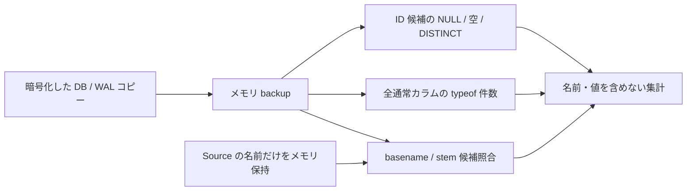

# Phase 0: ID 候補・格納型・名前対応候補の観測

- 日付: 2026-10-17（Asia/Tokyo）
- 環境: macOS 27.0.1 / 26A434、Voice Memos 4.0 / 1438
- Python / SQLite: 3.14.7 / 3.53.1
- 対象: DESIGN §2.3、O-001 / O-002 / O-003 / O-005
- 状態: 集計のみ。native ID と完全取得の契約は未確定。

## 方法と範囲

前回の [許可されたコピー取得](2026-10-17-readonly-db-capture.md) と同様、
Source DB / WAL は raw O_RDONLY で読み、SHM は開かない。
新規 AES-256 一時 image を repo 外に作り、暗号化を検証してからコピーを
置いた。SQLite はコピーにだけ接続し、メモリ backup 上で集計した。
最終的に detach 1 回で取り外し、一時コピー・image を削除した。
Source の書込み、アプリ操作、音声 / sidecar 内容読取、外部送信はしない。
以前から対象外のユーザー DB にもアクセスしていない。



`pocs/metadata_profile/` は次の規則で実験する。

- SQLite の通常テーブルを対象にし、view・virtual・shadow table と
   schema 自身を除外する。BLOB や非候補 TEXT の値は Python に取り出さず、
   `typeof()` の固定分類だけを数える。
- ID 候補はカラム名に `uuid / uniqueid / recordingid` があるもの。
   `path / filename / url` の候補も名前照合に使う。名前自体は出力しない。
- テーブルを名前順、カラムを cid 順に並べたゼロ始まりの slot だけを
   ID 集計の位置として出力する。slot は今回の観測内の位置であり、
   次回の schema 変更やホストをまたぐ永続識別子には使えない。
- NULL は `COUNT(*) - COUNT(column)`、空 TEXT / BLOB はバイト長 0、
   distinct は `COUNT(DISTINCT column COLLATE BINARY)` として数える。
   非空かつ全行が非 NULL・distinct の場合だけ観測上の一意性を true とする。
   0 行を一意な ID の証拠にはしない。
- 一意性は SQLite の同値判定である。INTEGER 1 と REAL 1.0 は同値で、
   raw バイト列の同一性やアプリの意味上の同一性を示さない。
   スキーマに UNIQUE 制約があるかも、この PoC では調べていない。
- ファイル名候補は既存の固定拡張子分類を使う。directory fd 相対の
   `O_NOFOLLOW` 走査で通常ファイルの basename だけをメモリに保持し、
   名前・パス・任意拡張子は出力しない。同名を複数 entry として保持する。
- basename 規則は DB 文字列の basename とファイルの basename の一致。
   stem 規則は DB 文字列の basename とファイルの stem の一致。
   DB 値の拡張子は除去しない。大小文字・Unicode 正規化・URL decode を
   行わない。非 TEXT は名前照合に使わない。
- 一致セル数、セルごとの候補ファイル数の合計、複数候補に一致するセル数を
   別々に数える。同じファイルを複数セルが参照しても重複排除しない。

## 上限とエラー

名前走査は全体 10,000 entry、深さ 4 が既定。深さ境界で directory が
残った場合も不完全な対応判定を返さず失敗にする。stat / open の失敗、
symlink への置換、directory の inode 置換、件数超過も部分結果を返さない。
ただし同時更新全般を防ぐ atomic snapshot ではない。

DB 検査は 64 テーブル、1 テーブル 512 カラム・10,000 行、全体 100 万セルを
上限とする。候補 TEXT を Python に取得する前にバイト長を検査し、
4,096 bytes 超なら失敗にする。非候補 TEXT は型集計のみなので、この
文字列長制限の対象ではない。DB コピー自体の 64 MiB 上限は維持する。
集計側は `trusted_schema=OFF / temp_store=MEMORY / query_only=ON`、
backup と query の deadline は約 5 秒。入力識別子は二重引用符で escape し、
エラーは固定文言へ縮減する。raw の SQLite 診断は出力しない。

## 実機の観測値

| 項目 | 件数・結果 |
| --- | ---: |
| 通常テーブル / カラム | 30 / 275 |
| ID 名称候補カラム | 8 |
| 値を持つ ID 候補カラム | 4 |
| 0 行の ID 候補カラム | 4 |
| 名前照合の候補カラム | 10 |
| 音声名 entry / sidecar 名 entry | 916 / 13 |
| 音声 basename 一致セル | 915 |
| 音声 basename 候補ファイル数のセルごとの合計 | 915 |
| 音声 basename 複数候補一致セル | 0 |
| 音声 stem 一致セル | 0 |
| sidecar basename / stem 一致セル | 各 0 |
| コピー側 quick_check | ok |
| Source DB / WAL の観測前後のバイト列 | 一致 |
| 音声 / sidecar 名一覧の観測前後 | 一致 |
| 暗号化した一時コピー | 削除済み |

音声 / sidecar の候補件数は以前の観測から変化している。別時点の一覧を
同じ snapshot として扱わない。今回の前後一致も音声内容や DB との
同一 revision を証明しない。915 セルは distinct な録音数・ファイル数ではない。

| ID 候補の slot (table, column) | 行 / 非 NULL / distinct | 格納型 |
| --- | ---: | --- |
| (7, 4) | 0 / 0 / 0 | 値なし |
| (21, 18) | 915 / 915 / 915 | TEXT |
| (21, 19) | 915 / 915 / 915 | BLOB |
| (23, 6) | 0 / 0 / 0 | 値なし |
| (24, 6) | 4 / 4 / 4 | TEXT |
| (26, 6) | 0 / 0 / 0 | 値なし |
| (26, 12) | 0 / 0 / 0 | 値なし |
| (27, 1) | 1 / 1 / 1 | TEXT |

各候補の空 TEXT / 空 BLOB は 0。非空の 4 カラムは観測上の一意性が true。
これらが recording / folder / account 等のどの意味を持つかは未確定。
同じ行数であることや名前のヒントを根拠に、録音 ID と決めない。

| 全通常カラムの格納型 | セル数 |
| --- | ---: |
| NULL | 37,003 |
| INTEGER | 84,095 |
| REAL | 14,733 |
| TEXT | 7,369 |
| BLOB | 11,069 |

NULL の意味は未解釈であり、`missing / unknown / not_applicable` のいずれかに
変換していない。前回の「宣言型」と今回の「格納型」は別の集計である。
sidecar 一致ゼロも関連情報の不存在・欠落を意味しない。
バイナリ ID、別命名規則、未知形式や DB 外の関連付けが残る。

## 合成検証と再現

```sh
uv run pytest --cov=pocs --cov-branch --cov-report=xml \
  --cov-fail-under=100 -W error::ResourceWarning
```

全 137 テスト成功、全 `pocs/` の分岐込み coverage 100%。新規 34 テストは
合成入力のみ。NULL、空値、重複、数値同値、NUL、NOCASE、引用符・日本語の
識別子、Unicode・大小文字差、同名ファイルの曖昧さ、virtual / shadow 除外、
上限・timeout・fd 解放・出力縮減を検証する。
サブエージェントによる独立レビューと境界テストも実施した。

再現 API は `collect_hints(approved_root)` と
`profile_database(isolated_copy, hints)`。後者に live DB を渡さない。
同意、暗号化と隔離、raw copy の検証、Source 観測前後の比較、cleanup は
操作者が担当する。専用 CLI は設けていない。

## 次の検証と未決事項

候補が一意でも native ID の契約にはできない。次は明示的に指定した合成録音
で、UI 上の ID / ファイル / metadata の対応、名称変更・編集前後の ID と
revision の変化、原本の無変換 export を検証する必要がある。
Source への変更は今回の read-only 許可に含まれないため実施していない。

raw 値・未知フィールドの型付き保全、音声 / sidecar の関連性と snapshot
一貫性、materialization、復元可能性は未検証。取得完全性・ID 安定性・
snapshot 一貫性は UNKNOWN、削除は無効、Phase 0 Go 判定は保留とする。

参照: [SQLite aggregate](https://www.sqlite.org/lang_aggfunc.html)、
[SQLite type / comparison](https://www.sqlite.org/datatype3.html)、
[table_list](https://www.sqlite.org/pragma.html#pragma_table_list)。
