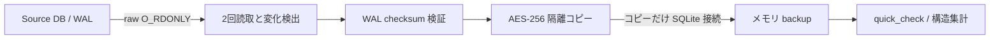

# Phase 0: 許可された DB / WAL コピーの実機調査

- 日付: 2026-10-17（Asia/Tokyo）
- 環境: macOS 27.0.1 / 26A434、Voice Memos 4.0 / 1438
- Python / SQLite: 3.14.7 / 3.53.1
- 対象: DESIGN §2.2 / §2.3、O-001 / O-002 / O-003 / O-005
- 状態: 隔離コピーの DB 内部整合性と構造の集計を確認。Phase 0 は未完了。

## 同意とデータの扱い

ユーザーから「読み取り専用であれば、DB コピーなどをしてもよい」と
明示許可を得た。Source に書き込む権限、アプリ操作、クラウド送信、
削除の許可とは解釈しない。対象は前回確認した application group root
内の DB 候補 1 件と、その同名 WAL だけとした。
未追跡のユーザー DB は対象に含めず、読み書きしていない。

repo 外の 0700 一時 directory に AES-256 の APFS ディスクイメージを
作成した。ランダムな使い捨てパスフレーズを子プロセスの stdin に渡し、
引数・環境変数・ファイル・ログに保存しなかった。imageinfo の
`Properties.Encrypted == true` を確認してから private copy を置いた。
復旧用の長期バックアップではなく、一時的な調査コピーである。
プロセスメモリ、swap、crash dump の保護は引き続きホスト依存。

## 取得と検査の手順



1. まず合成バイト列で暗号化 image の生成・mount・読取・detach を確認。
1. 実機取得用にも別の一時 image を作成。`-nospotlight`、`-nobrowse`、
   `-noautoopen` を指定し、private subdirectory を 0700 で作成。
1. Source の parent directory と DB / WAL を `O_NOFOLLOW` で開く。
   DB / WAL は `O_RDONLY | O_NONBLOCK`、通常ファイルに限定する。
   SHM は開かず、コピーしない。各ファイルの上限は 64 MiB。
1. DB / WAL の fd を保持して組全体を 2 回読む。各段階で同名 entry と
   fd の device / inode / size / mtime / ctime を比較する。
   WAL の出現・消失、置換、属性・バイト変化、rollback journal の存在は拒否。
1. DB header、WAL header / frame の checksum、salt、page size、
   commit 終端を検証してから、0700 の新規 copy directory に保存。
   ファイルは 0600。既存 directory / ファイルは上書きしない。
1. SQLite は隔離コピーだけを `mode=ro` で開く。コピー側で SHM を
   再構築し、backup API でメモリへ複製する。検査は約 5 秒で打ち切る。
   `trusted_schema=OFF`、メモリ側は `temp_store=MEMORY` とする。
1. `quick_check` の成功後に構造を集計。実機 DB / WAL のバイト列を
   取得前後でも比較し、変化を検出しなかったことを確認する。
1. detach 後、一時 image と directory を削除。パスフレーズは保持しない。

初回試行は detach が一度失敗したため、取得成功として扱わなかった。
Source を操作せず再度 detach し、成功と一時 directory 削除を確認した。
後処理で取得結果を失わないよう実行手順を修正して再試行した。
最終試行では取得・検査が成功し、detach 1 回でコピーを削除できた。
これは crash や強制終了時の自動 cleanup を保証するものではない。

## 観測結果

| 項目 | 結果 |
| --- | ---: |
| WAL | あり |
| 各組の 2 回読み取り | バイト列一致 |
| 実機 DB / WAL の取得前後 | バイト列一致 |
| 隔離コピーの quick_check | ok |
| スキーマオブジェクト | 77 |
| テーブル | 30 |
| カラム | 275 |
| ID 名称ヒントに一致するカラム | 8 |
| 一時コピー | detach 後に削除済み |

ID のヒントは名前に `uuid / uniqueid / recordingid` のいずれかがあること
だけである。ID 値、一意制約、NULL、名称変更・編集後の安定性は未検証。
録音行数も数えていない。スキーマ名、DDL、録音名、行値、パス、
fingerprint は出力・コミットしていない。

| 宣言型の固定分類 | カラム数 |
| --- | ---: |
| INTEGER | 173 |
| BLOB | 28 |
| REAL / TEXT / NUMERIC | 各 0 |
| その他 | 74 |

この分類は宣言型の完全一致であり、SQLite affinity や格納値の型ではない。
例えば VARCHAR は「その他」となる。TEXT 0 は文字列データ不存在を
意味しない。raw の型名・値・未知フィールドを取得保存したとは扱わない。

## 再現コードと合成検証

`pocs/sqlite_capture/capture.py` の関数は明示 DB と保護先を受け取る。
暗号化ボリューム作成、承認、Source の選択、cleanup は操作者が担当する。
関数自体は暗号化や repo 外への隔離を検証しないので、一般の temporary
directory を実機データの保存先に使わない。専用 CLI は設けていない。

```python
from dataclasses import asdict
from pathlib import Path

from pocs.sqlite_capture.capture import capture_database

# 実行前に同意・暗号化・隔離を確認し、実行後に detach / cleanup する。
report = capture_database(
    Path("/explicit/approved/source.sqlite"),
    Path("/mounted/encrypted/private"),
)
print(asdict(report))
```

```sh
uv run pytest --cov=pocs --cov-branch --cov-report=xml \
  --cov-fail-under=100 -W error::ResourceWarning
```

全 103 テスト成功、全 PoC の分岐込み coverage 100%。新規 48 テストは
合成入力のみで、WAL の両 endian・checksum・salt・破損・未 commit tail、
ファイルの変化・追加・消失・置換、上限、非通常ファイル、fd 解放、
タイムアウト、情報縮減、元 DB / WAL / SHM のバイト列不変を確認する。
サブエージェントによる WAL 実装と独立安全性レビューも実施した。

## 残る限界と判断

- raw read による atime、キャッシュ、OS materialization の影響は除外しない。
   Source に書込み syscall や SQLite 接続を行わなかった範囲での read-only。
- 2 回一致でも ABA やファイル間の瞬間的混在を排除できない。
   WAL checksum は DB との由来の一致や暗号学的真正性を証明しない。
- checksum-valid でも stale / 未 commit tail があれば保守的に拒否する。
   合法な稼働中 WAL を取得できない場合があり、汎用取得 adapter ではない。
- `quick_check` は DB 内の一部整合性のみ。最新性、全 constraint、
   音声 / sidecar の同一 revision、完全取得・復元可能性を証明しない。
- Source parent の親要素と保護先は操作者が信頼する。Source の rename、
   mount 変更全般や悪意ある DB を sandbox 化する実装ではない。
- raw metadata、native ID 安定性、音声 / sidecar、cloud materialization、
   1 録音の無変換 export は未検証。O-001 / O-002 / O-003 / O-005 は未決。

取得完全性・snapshot 一貫性は UNKNOWN、削除は無効、Go 判定は保留。
本手順を本番の安全な snapshot 契約として採用しない。

参照: [SQLite file format](https://www.sqlite.org/fileformat.html#walformat)、
[WAL / SHM](https://www.sqlite.org/walformat.html)、
[URI](https://www.sqlite.org/uri.html)。OS コマンドは実機の
`hdiutil create / attach / imageinfo -help` を確認した。
macOS 27 では hdiutil の当該サブコマンドは deprecated と表示される。
