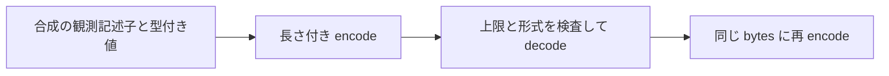

# Phase 0: 合成 record envelope の可逆性検証

- 日付: 2026-10-17（Asia/Tokyo）
- 環境: Python 3.14.7、macOS ホスト上の合成メモリ入力のみ
- 対象: DESIGN §2.3、O-002
- 状態: 実験用 container の検証。保存形式・Source adapter は未採用。

## 目的と範囲

[単一値 codec](2026-10-17-typed-metadata.md) は値の型と bytes を保持するが、
値の長さ、schema、encoding、観測との対応付けを含まない。
`pocs/record_envelope/` は、それらを明示した 1 行分の container を合成入力で
往復する。DB / filesystem / network / GUI にアクセスする API は設けない。
実機の私的なデータも、既存の `SyntheticState` も入力にしていない。



入力は caller が構築する `Record`。table 名・SQL・列名・宣言型の記述子は
UTF-8 として encode し、Unicode 正規化しない。一方、SQL TEXT の bytes は
元の UTF-8 / UTF-16le / UTF-16be の encoding ラベルと別に保持し、Unicode
へ decode しない。不正な TEXT bytes も変更しない。encoding ラベルが値の
実際の encoding と一致するかを、この codec が立証するわけではない。

## 実験用の形式

整数と長さは unsigned big-endian uint32。field は 4 byte の長さに bytes を
続ける。frame 自体に checksum・署名・暗号化は含めない。

| 順序 | 内容 |
| --- | --- |
| 1 | magic `VMAR`、envelope version 1、value-codec version 1 |
| 2 | 固定 provenance field |
| 3 | caller の observation ID field、table slot、row slot |
| 4 | SQLite TEXT encoding、table 名、table SQL の field |
| 5 | column count |
| 6 | 列順に name / declared type の field |
| 7 | 同じ列順に型付き単一値 frame の field |

固定 provenance は `caller-supplied-synthetic-sql-observation`。
これは入力の想定を宣言するラベルで、SQL での採取や Source を認証する証拠
ではない。observation ID は合成の観測識別子で、録音 ID ではない。
table / row slot はその観測内の位置に限り、別観測との安定性や一意性を
保証しない。同じ内容の行や列を deduplicate しない。

column count と値数が違う入力を拒否する。空の記述子・重複した列名・未知の
宣言型はそのまま保持し、SQL schema としての妥当性を検査しない。
NULL と空 TEXT / BLOB は区別し、NULL を missing / unsupported /
not_applicable 等へ割り当てない。

型付き値は既存 `raw_metadata.values.decode_value()` で型・長さを検査する。
検査後も元 frame の bytes を保存し、REAL を Python float から作り直さない。
これにより NaN payload・signaling NaN・負のゼロを元 bytes のまま保持する。

## 上限と不正入力

| 項目 | 上限 |
| --- | ---: |
| frame 全体（header / 長さを含む） | 8 MiB |
| 記述子 field の UTF-8 bytes | 1 MiB |
| cell の本体（type tag を除く） | 1 MiB |
| columns / cells | 1〜512 |
| observation ID | 1〜64 bytes |
| table / row slot | 0〜2^32−1 の int、bool は拒否 |

encode は UTF-8 化前にも文字数を制限し、蓄積前に frame の残り容量を確認
する。decode は全体の容量を先に確認し、長さと残量を検査してから field を
切り出す。全体上限は payload の bytes が Python に渡された後の検査であり、
呼出前の読込・割当量を制限する API ではない。ピークメモリには入力・
container・再 encode のコピー等も含まれ、8 MiB が RSS 上限ではない。

未知 magic / version / provenance / encoding、不正 UTF-8 記述子、不正な
単一値 frame、切断、余剰 bytes、上限超過は固定の `EnvelopeError` で拒否する。
診断は `Invalid record envelope` のみで、例外 context の表示を抑制する。
これは型注釈に沿う `Record` / `bytes` 入力の形式検証で、任意の Python
object を扱う汎用 serializer ではない。

`Record` / `Column` は repr を無効にする。ただし、field にアクセスすれば
内容を取り出せるため秘匿機能ではない。実データでの利用・ディスク保存・
ログ・外部送信は今回の対象外である。

## 検証と限界

合成テストで全 5 格納型、int64 両端、IEEE754 の特殊値、NUL、不正 TEXT、
未知 BLOB、3 種類の encoding、Unicode 記述子を往復した。全ての byte 位置
で切断を試し、末尾余剰、巨大な宣言長、全上限の境界、未知 version 等を
拒否した。独立に組み立てた wire fixture とも一致した。

この形式は渡された記述子とセルの往復だけを検査する。SQL での採取、
record 選択、schema の正確性、全未知フィールドの列挙、他 table / index /
trigger / view、編集履歴・音声・sidecar の対応付けは検証しない。
SQLite 物理レコードや全 schema の保全、完全取得、native ID の契約、
atomic snapshot、永続保全、暗号化、忠実な復元の証拠ではない。
有効な別内容への改変は検出せず、外部の integrity / authenticity 検証が必要。
取得完全性は UNKNOWN、restorability は UNTESTED、削除は無効のまま。
O-001 / O-002 / O-003 / O-005 と Phase 0 Go 判定は引き続き未決とする。

## 実行結果

```sh
uv sync --locked
uv run pytest pocs/record_envelope
```

専用 57 テスト、全体 327 テストが成功。全 `pocs/` の分岐込み coverage は
100%。Ruff check / format、ty、mypy strict、変更 Markdown lint、diff check
も成功した。サブエージェントが実装を独立レビューし、専用 57 テストと型検査
の成功を確認した。実機 Source / Voice Memos への追加アクセスは行わない。
