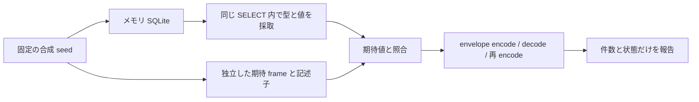

# Phase 0: 合成 SQLite から record envelope への対応検証

- 日付: 2026-10-17（Asia/Tokyo）
- 環境: Python 3.14.7 / SQLite 3.53.1、macOS ホスト
- 対象: DESIGN §2.3、O-002
- 状態: 自作の合成メモリ DB のみ。実機取得・保存形式採用は未実施。

## 目的と実験の境界

[record envelope](2026-10-17-record-envelope.md) の初回検証は caller が渡した
記述子と型付き値を扱い、SQL での採取は対象外だった。
`pocs.record_trial.trial.run_trial()` は引数を取らず、固定の合成 DB を
メモリ内に作り、SQL 観測結果と container の往復を結び付ける。
Source、任意 DB、path、connection、外部データを受け取る公開 API はない。
DB の作成・挿入は合成入力だけに行い、実機・音声・ネットワークへ接続しない。



schema 作成前に UTF-8 / UTF-16le / UTF-16be を設定し、観測時に実際の
PRAGMA encoding と照合する。seed 完了後は trusted_schema=OFF、
temp_store=MEMORY、query_only=ON。観測段階で書込が拒否されることも検査する。

## 固定入力と採取方法

各 encoding で次の 2 table を作る。

| table | 内容 |
| --- | --- |
| 引用符を含む合成 table | 11 列、同じ値の 2 行、VIRTUAL / STORED generated 列 |
| WITHOUT ROWID table | 3 列、TEXT primary key の異なる 2 行 |

NULL、int64 両端、REAL 1.5、Unicode / NUL / 結合文字の TEXT、空 TEXT、
opaque / 空 BLOB、未知の宣言型と未知列を含む。generated 列は整数加算と
TEXT 連結で、元セルとの対応も既知の期待値と照合する。

通常 table の列挙結果、sqlite_schema の CREATE TABLE SQL、cid 順の
pragma_table_xinfo の列名・宣言型・hidden flag を固定の期待値と比較する。
生成列の hidden=2 / 3 も含め、table_info による除外を避ける。
hidden flag は検証対象だが envelope の独立 field には保存しない。
生成式や VIRTUAL / STORED 記述は table SQL に含まれる。

型と値は各行の同じ SELECT で採取する。TEXT は CAST(value AS BLOB) とし、
その DB encoding の bytes を保持する。列ごとに別走査して zip する方法は
使わない。SQL 値を既存の単一値 codec で frame にし、seed から直接作った
期待 bytes と照合する。期待値を extraction / encode_value で作り直さない。

record の SQL / 列記述子 / 全セルと、decode 後の結果を期待値と照合し、
再 encode 後の bytes も比較する。行数は strict zip で欠落・余剰を拒否し、
失敗時は部分結果を返さず `Synthetic SQL record trial failed` だけを返す。

重複表は rowid 順、WITHOUT ROWID 表は固定 primary key の BINARY 順を
この実験の観測順として使う。重複行を deduplicate しない。rowid は envelope
へ録音 ID として保存せず、row slot はこの観測内の位置に限る。
観測ラベルは encoding ごとの固定合成 bytes で、試行間の一意性や identity
を保証しない。descriptor は UTF-8、cell TEXT は別の SQLite encoding。

## 結果と再現

```sh
uv run python - <<'PYTHON'
from pocs.record_trial.trial import run_trial

print(run_trial())
PYTHON
```

| 項目 | 結果 |
| --- | ---: |
| メモリ DB / table | 3 / 6 |
| 期待値と往復一致した record | 12 |
| 期待値と往復一致した cell | 84 |
| generated column の記述子 | 6 |
| 保持した重複行の組 | 3 |
| encoding | UTF-8 / UTF-16le / UTF-16be |

record / SQL / 値 / encoded bytes は出力しない。表の generated column は
記述子の数で、同じ列に属するセル数とは区別する。

専用 14 テスト、全体 341 テスト、全 `pocs/` の分岐込み coverage 100% が
成功。Ruff check / format、ty、mypy strict、変更 Markdown lint、diff check
も成功した。サブエージェントの独立レビューと専用テスト・型検査も成功。
追加・欠落した行、未知 table、SQL / 列順 / hidden / 値の不一致、誤 encoding、
codec の故障、SQLite エラーを注入し、失敗の情報縮減を確認した。

## 限界と残る課題

これは固定された小さい合成 schema の実験である。任意 DB を安全に列挙する
resource guard / deadline / snapshot API は追加していない。
全 table の一般的な採取、index / trigger / view / virtual / shadow table、
schema の完全保存、Source の record 選択、audio / sidecar の関連性、
同時変更や Cloud materialization を検証するものではない。

SQL で観測できる値だけを扱う。SQLite が格納・評価・SQL 応答の前に変換した
入力のビット表現や物理レコードを復元することはできない。単一値 codec の
NaN / 負のゼロのビット保持と、SQLite を通した取得の保証を混同しない。
固定 provenance も採取元を認証しない。永続保存や実機 raw metadata 保全、
完全取得、native ID の安定性、忠実な復元の証拠へ昇格させない。

取得完全性は UNKNOWN、restorability は UNTESTED、削除は無効。
O-001 / O-002 / O-003 / O-005 と Phase 0 Go 判定は引き続き未決とする。
