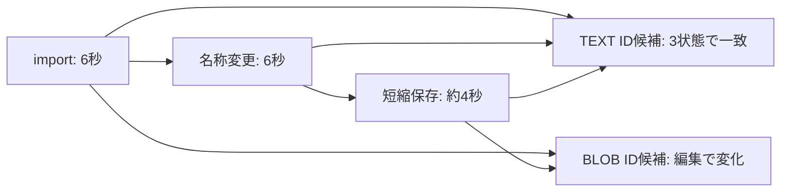

# Phase 0: 合成録音の名称変更・編集・無変換 export

- 日付: 2026-10-17（Asia/Tokyo）
- 環境: macOS 27.0.1 / 26A434、Voice Memos 4.0 / 1438
- 対象: DESIGN §2.2 / §2.3 / §15、O-001 / O-005
- 状態: 合成 1 件・当該 build での限定観測。Go 判定は保留。

## 許可と合成入力

ユーザーは「合成録音の作成・名称変更・編集も許可する」と明示した。
既存の私的な録音を変更せず、新規の合成 1 件だけを対象とした。
録音の削除・完全削除は実装も実行もしていない。

`pocs/synthetic_audio/tone.py` で 48 kHz / mono / PCM16 の 6 秒 WAV を
生成した。220 / 440 / 880 Hz を各 2 秒、振幅 0.15 で構成する。
マイクや周辺の会話は録音せず、既存音声も入力に使っていない。
macOS の afconvert で、この合成 WAV から AAC / M4A 入力を別途作成した。
実録音の原本を再エンコードしたものではない。

生成先は repo 外の `/tmp/vma-phase0-20261017/`。公開用の合成名は
`VMA-Phase0-20261017`、最終名は `VMA-Phase0-20261017-Renamed` とした。
合成入力・export はここに残し、private DB コピーは別の暗号化 image に
隔離して最後に削除した。音声バイナリや private 値は Git に入れていない。

## アプリ経由の操作

1. ユーザーに合成名で検索してもらい、No Recordings の状態を確認した。
   外部にファイルがあるだけでは Voice Memos の DB 登録にはならない。
1. File メニューには import 項目が見当たらなかった。Finder の合成 M4A
   だけを Open With → Other → All Applications → Voice Memos で一度開いた。
   Always Open With はオフのままとし、既定アプリは変更していない。
1. 検索結果に合成名の 6 秒の録音 1 件が出たことを確認した。
1. コピー側 DB で合成 prefix に一致する行を一意に特定し、初期観測を取得。
1. UI の title を `-Renamed` に変更し、再度観測した。
1. Edit Recording → Trim で終端をドラッグし、0〜約 3.87 秒を選択。
   Trim → Done → Done → Save Recording を選び、同じ録音として保存した。
   Save as New Recording や Delete は選んでいない。
1. 保存後の検索を合成 prefix に戻し、表示が約 4 秒になったことを確認。
   編集後の DB と対応する音声を観測し、private コピーを削除した。

AppleScript の UI 経路は assistive access の拒否だったため採用せず、
既存権限の Computer Use 経路を使った。権限設定の変更は行っていない。
途中の Escape で検索が解除され、既存名が一度 AX 出力に含まれた。
以後は AX を emit:false で読み、合成名と操作コントロールだけを出力した。
既存名や当該画面のコピーを成果物へ転載していない。
アプリの通常 iCloud 同期の発生・完了は未測定で、独自 cloud API は使わない。

## DB の比較と ID 候補

各観測は raw O_RDONLY で DB / WAL を読み、AES-256 の隔離コピーだけに
SQLite 接続した。各取得内の DB / WAL 前後はバイト列一致、quick_check 成功。
SHM は開かず、DB へ直接書き込んで録音を登録・変更していない。

`observe.py` は ID 名称と path 名称の候補を持つ通常テーブルから、
合成 prefix に一致する行を一意に選ぶ。複数行・複数テーブルなら拒否する。
名前・ID 値は出力せず、typed SQL 値をメモリ内だけで比較する。
path の解釈は UTF-8 DB 限定で、他 encoding を拒否する。



| 比較項目 | 名称変更後 | 短縮保存後 |
| --- | --- | --- |
| 合成行の一意な選択 | 成功 | 成功 |
| TEXT ID 候補 | 初期値と一致 | 初期値と一致 |
| BLOB ID 候補 | 初期値と一致 | 初期値から変化 |
| path 候補 | 一致 | 一致 |
| typed SQL 全セル | 変化あり | 変化あり |
| 対応音声のバイト列 | 一致 | 変化あり |

同じテーブル位置で 2 ID 候補を比較した。名前のヒントだけで両方を永続 ID
と扱うことはできない。TEXT 側の一致は有用な証拠だが、録音の一意安定な
native ID と採用するには、意味・別操作・同期・再起動・別ホスト等の追加検証が
必要。BLOB 側を revision ID 等と決める根拠も、まだ足りない。

## 無変換 export と照合

合成行の path 候補と Source 内の音声 basename が一意に対応することを
確認した後、その 1 ファイルだけを raw O_RDONLY で 2 回読んだ。
バイト列・inode・size・mtime・ctime の一致を確認し、別ファイルへそのまま
保存した。読み戻した size / SHA-256 と元の値が一致した。

| 状態 | bytes | SHA-256 |
| --- | ---: | --- |
| import / 名称変更後 | 94,200 | 下記 A |
| 短縮保存後 | 61,734 | 下記 B |

```text
A: 34b51dbc701b8773e802bf287a2ae584f37178d48258b0c0131d157d9edf6088
B: a1ae81f8eb3e48f6f48de7898f85e31c43681d92f6fdd07289e758a3952e4596
```

初期・名称変更後・編集後は別名の export に残し、初期コピーを上書きして
いない。`export_audio()` に同方式の再現コードと故障テストを置き、
編集後 export を入力とした追加の読み戻し検査も B / 61,734 bytes に一致した。
API 自体が「合成録音」を判定するわけではなく、操作者の正確な指定が必要。
出力作成後の失敗では不完全な出力が残る場合がある。

取り込み前の M4A と Source の import 後の全 bytes は一致しなかった。
ホスト既存の ffmpeg 9.0.2 で AAC 圧縮ペイロードを抽出した結果は次のとおり。
このツールをプロジェクト依存や CI の前提には追加していない。

| 検査 | 結果 |
| --- | --- |
| input / import の AAC ペイロード | 91,927 bytes、SHA-256 一致 |
| 編集後の AAC ペイロード | 59,885 bytes、初期から変化 |
| ffprobe の形式 | 全て AAC / 48,000 Hz / mono |
| ffprobe の stream duration | 初期 6.058667 / 編集後 3.925333 秒 |
| ffmpeg のローカル decode | 3 export 全て成功 |

圧縮ペイロード一致でも、コンテナ全体や全 metadata の一致ではない。
UI の丸めた秒数、trim 選択時間、圧縮 stream duration は同じ指標ではない。
再生・decode 成功を Voice Memos の忠実な復元とみなさない。

## 検証と残る課題

合成入力生成・対象選択・ID 候補別比較・raw export に専用テストを置いた。
上書き拒否、UTF-16 拒否、曖昧な行、値・サイズ・件数上限、symlink / FIFO、
読取中の変化、SHA-256 / size の不一致、固定診断を検証する。
private state は repr / ログ / serialization の対象にしない。
統合検査は全 259 テスト成功、全 `pocs/` の分岐込み coverage 100%。
Ruff、ty、mypy strict、Markdown / YAML / workflow lint も成功した。

本実験は特定 build の imported synthetic 1 件だけの観測である。
マイク由来の録音、重ね録り、文字起こし、全編集履歴、再同期、cloud
materialization、DB と全音声 / sidecar の atomic snapshot、別ホストでの
復元は未検証。合成録音は削除せずアプリ内に残している。
O-001 / O-002 / O-003 / O-005、完全性の契約、Phase 0 Go 判定は未決のまま。
