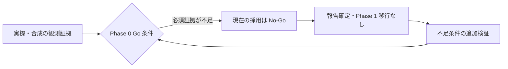

# Phase 0 最終報告書 — macOS Source の実行可能性評価

- 文書 ID: VMA-P0-REPORT-001
- 版: 1.0
- 報告日: 2026-10-17（Asia/Tokyo）
- 対象設計: `docs/DESIGN.md` v0.1.0、§2 / §15 / §16
- 評価基準となる実装: `cc6f770184256c0fb03370146da298a355513e31`
- 状態: 調査・評価・報告を終結。Go 条件の技術的達成は未完了。
- 最終判定: **現方式の本番 Source adapter 採用・Phase 1 移行は No-Go**
- 安全状態: **取得完全性 UNKNOWN、Source の復元 UNTESTED、削除無効**

## 1. 結論

macOS 27.0.1 / build 26A434、Voice Memos 4.0 / 1438 において、保存先の
到達性、読み取り専用の DB / WAL コピー、SQL 観測値の型付き往復、合成録音
1 件の名称変更・編集・音声の無変換 export を限定的に実証した。

一方、source-scoped native recording ID、DB / 音声 / sidecar の同一 revision、
Cloud materialization、全関連メタデータの取得可否・欠落検出は未確立である。
DESIGN §15 の Go 前提である法的・保守上の許容確認も完了していない。
この証拠不足により、現在の private store 取得案を採用せず、次フェーズへ
自動移行しない。追加の codec や unit test では、この証拠不足を解消できない。

本報告書の完成をもって今回の feasibility 調査を終結する。これは、全技術
検収条件を達成した「Phase 0 成功完了」ではない。取得方式の恒久的不可能性も
示していない。未解決事項は再評価条件とともに残し、将来の検証で判定を改訂
する。過去の個別記録にある「未完了・保留」は各観測時点の履歴として保持し、
現在の評価結論は本報告書を参照する。



## 2. 評価範囲と判定方法

DESIGN §15 の Phase 0 成果物は、build 別 source inventory、ID 安定性、
raw metadata、1 録音 export である。Go は取得可能性と法的・保守上の許容を
確認して判断する。次の区分で証拠を評価した。

- **限定実証**: 指定 build・対象・操作に限って測定した。
- **未達**: 必要な契約や取得結果を示す証拠が揃っていない。
- **未実施**: 当該実験・評価を行っていない。不可能の立証ではない。
- **対象外**: この段階で要求されない、または許可されていない。

別ホストからの Target restore、複数 provider の replication は Phase 1 の
成果物であり、Phase 0 の追加必須条件にはしない。DESIGN §1.1 では Voice
Memos の内部 ID・編集履歴まで戻す忠実な再インポートは初期スコープ外。
その未実証だけを No-Go の理由にはしない。一般音声 decode の成功と、取得
情報の完全性・アプリ状態の復元は分けて扱う。

## 3. 環境・同意・方法

| 項目 | 実測値・範囲 |
| --- | --- |
| macOS / build | 27.0.1 / 26A434 |
| Voice Memos | 4.0 / 1438、com.apple.VoiceMemos |
| Python / SQLite | 3.14.7 / 3.53.1 |
| uv / ffmpeg | 0.13.1 / 9.0.2 |
| 実機範囲 | 単一ホスト・単一 build、許可済み source |
| 変更対象 | 新規合成録音 1 件の作成・名称変更・短縮編集のみ |
| 最終確認 | ホスト版、合成 export、合成実験、全品質検査を再実行 |

読み取り専用 DB コピーは明示許可済み。元 DB / WAL を raw O_RDONLY で読み、
SHM は開かずコピーもしない。repo 外の AES-256 APFS image の暗号化を検査
した後、隔離コピーだけを SQLite で開いた。パスフレーズは使い捨てとし、
引数・環境変数・ファイル・ログへ保存しなかった。[E03]

本報告の最終確認で扱う Source 関連データは、既存の合成ファイルと
合成 DB 実験のみとし、実機 DB 再取得や Voice Memos の追加操作は行っていない。
既存の私的録音の変更、独自 CloudKit 書込、Source 削除、実データの fixture 化・
Git 格納・外部解析送信は実施していない。通常のアプリ操作に伴う iCloud 同期
の発生・完了は測定していない。

## 4. 成果物と Go 条件の評価

| 条件 | 得られた証拠 | 判定 |
| --- | --- | --- |
| build 別 inventory | 到達性、構成候補、DB 構造の件数 | 限定実証 |
| native ID 安定性 | 合成 1 件の rename / trim の候補値比較 | 未達 |
| raw metadata | SQL 値の往復、合成 record container | 実機保全は未達 |
| 1 録音 export | 原本 bytes コピー、readback、decode | 限定実証 |
| 法的・保守上の許容 | 内部形式依存・更新リスクを記録 | 許容判断は未実施 |

### 4.1 到達性と構成

権限拒否後の再試行で root 直下 3 entry の列挙に成功した。[E01]
後の構成観測は全 1,093 entry、29 directory、symlink 1、DB / WAL / SHM
候補各 1、音声候補 914、sidecar 候補 12、その他通常ファイル 134。
深さ境界での未訪問 directory は 0 だった。[E02]

これは固定拡張子による分類で、音声候補数は録音数・原本数ではない。
別時点の名前照合では音声 entry 916、sidecar entry 13 だった。[E04]
時点の違う値を同一 snapshot や増減した録音数として合成しない。

### 4.2 DB / WAL の取得と snapshot

DB / WAL の組を 2 回読み、bytes・inode・size・mtime・ctime・同名 entry を
照合した。各ファイル上限 64 MiB、WAL checksum / salt / page size / commit
終端を検査し、コピー側 quick_check は成功。77 schema object、30 table、
275 column、ID 名称候補 8 column を集計した。[E03]

二重読取と quick_check は、最新性、ABA の排除、DB 外との原子性を示さない。
stale / 未 commit tail がある合法 WAL も保守的に拒否し得る。
raw read の atime・cache・OS materialization への影響も排除しない。
本手順を本番の安全な snapshot 契約として採用しない。

合成反例は最終確認でも再現した。main-only copy と immutable 読取は 0 行、
backup は確定済みの 1 行を取得。未 commit 行は混入せず、DB backup 後の
外部ファイル更新では DB 内 digest と取得 bytes が不一致だった。[E05]
これは実機の更新順序そのものを再現したものではない。

### 4.3 ID と revision の候補

ID 名称候補 8 列中 4 列に値があり、その観測内では NULL・空値・重複なし。
同じ table の TEXT / BLOB 各 1 列は、それぞれ 915 行の distinct 値を持った。
915 は distinct recording 数と確定した値ではない。[E04]

許可済み合成録音を実際にアプリへ import し、名称変更、短縮保存を行った。
TEXT ID 候補は 3 状態で一致、BLOB 候補は名称変更で一致し短縮保存で変化。
path 候補は一致し、typed SQL セルと音声 bytes は編集で変化した。[E08]

この実機比較の当時の API は table / column context を検証していなかった。
後の guard 修正は合成テストのみであり、補強後の実機再検証ではない。
BLOB 候補を recording ID と断定して「ID 不安定」と結論せず、TEXT 側も
native ID と採用しない。再起動・再同期・他操作・source scope の意味の証拠が
不足している。

### 4.4 raw metadata と sidecar

実機コピーの最終 typed-value 試行では、UTF-8 の 154,351 セル全てが往復一致。
NULL 37,024、INTEGER 84,143、REAL 14,741、TEXT 7,369、BLOB 11,074。
154,269 セルの別試行とは区別する。値はメモリ内で検査し、保存していない。
SQL 観測型と TEXT / BLOB bytes のメモリ内往復で、物理表現ではない。[E06]

sidecar の候補 13 件は binary plist 署名 2、XML 系 10、JSON 系 1。
署名の接頭辞だけの判定で、構文・record 関連性は未検証。[E07]
名前照合の sidecar 一致 0 は、関連情報の不存在や欠落の証拠ではない。[E04]
編集履歴・transcript・layer・未知形式の取得可否や欠落検出は確定していない。

合成 record envelope は version / 長さ / schema 記述子 / encoding / 観測内
位置と型付き値の往復を検査した。合成 SQL trial では 3 encoding・6 table・
12 record・84 セル、generated column 記述子 6、重複行 3 組が一致。[E09][E10]
この成功は実機 record の採取・永続保全・全 schema 保全を実証しない。

### 4.5 合成 1 録音の export と最終再確認

合成入力は 6 秒、48 kHz、mono PCM16、220 / 440 / 880 Hz を各 2 秒とした。
別途 AAC / M4A にして Finder 経由で Voice Memos に import。最終名は
`VMA-Phase0-20261017-Renamed`。短縮後の UI 表示は約 4 秒だった。
この 1 件は削除せず残している。最終報告作成時に UI の再確認はしていない。

Source に対応すると確認した合成音声だけを無変換で別ファイルへコピーし、
元の二重読取と読み戻し size / SHA-256 の一致を確認した。[E08]
最終確認でも、残された合成 export の size / digest と decode が一致した。

| 対象 | bytes | SHA-256 |
| --- | ---: | --- |
| import / renamed export | 94,200 | A |
| edited / verified-edited export | 61,734 | B |

```text
A: 34b51dbc701b8773e802bf287a2ae584f37178d48258b0c0131d157d9edf6088
B: a1ae81f8eb3e48f6f48de7898f85e31c43681d92f6fdd07289e758a3952e4596
```

全て AAC / 48 kHz / mono。stream duration は初期 6.058667 秒、編集後
3.925333 秒だった。UI 秒表示・trim 選択時間と同じ指標ではない。

input M4A は 96,023 bytes で import export のコンテナ全体とは不一致。
最終確認で `-map 0:a:0 -c:a copy -f data pipe:1` により取り出した AAC
packet payload の連結は、input / import / renamed が各 91,927 bytes で
SHA-256 一致、編集後は 59,885 bytes へ変化した。ADTS 出力の長さとは異なる。

```text
初期 payload:
6d4167ed1f152795a4f961d1049b24906b8fe6f820b029db6ff669f72a750d49
編集後 payload:
85a4f58d5607d70b93cca94facf6ff3457de459bc994244ae6ca52399ae52308
```

input と 4 export の全 5 ファイルが ffmpeg で decode 成功した。ffmpeg は
ホスト既存ツールで、プロジェクト依存・CI 前提に追加していない。
これはローカル decode の証拠であり、元アプリ状態の忠実な復元ではない。

## 5. No-Go 条件の対応表

| DESIGN §15 の論点 | 現状 | 採用判断 |
| --- | --- | --- |
| source native ID が一意安定 | 候補の意味・scope・長期安定性が未証明 | 不足 |
| 録音・編集中の snapshot | 合成反例あり、実機の整合取得契約なし | 不足 |
| materialize の検証 | Cloud 完了・未取得を安全に区別できていない | 不足 |
| metadata 欠落の検出 | 必須対象と未知情報の列挙が未確立 | 不足 |
| 削除の誤対象 | 削除 API 未実装・無効 | 安全性の立証には使わない |
| proof 不足の auto delete | 実施・要求なし | 今回は対象外 |
| 重大な security / privacy issue | 下記の露出記録と対処あり | 無欠陥を主張しない |

「不足」は失敗・不可能を実機で立証したという意味ではない。必要な安全証拠
を出せない現方式には Go を与えない、という採用判断である。

公開資料では [iCloud 同期][S1]、[Finder への export][S2]、[編集][S3] の
利用手順を確認した。今回確認した資料から、列挙・raw metadata・安定 ID・
原子 snapshot を一体提供する公開 API は確認できなかった。公開 API 全体の
不存在は断定しない。private store の利用許諾・配布条件・継続保守の受容判断は
未評価であり、法的に許可済み・禁止といずれにも断定しない。

## 6. 安全性・データ処分・PoC の扱い

実機の暗号化一時 DB コピーは各実験で detach 後に削除したと記録されている。
一度 detach が失敗し、再試行で解除・削除を確認した。crash cleanup の保証は
ない。本報告では私的な保存先の再走査をせず、過去の cleanup 記録を引用する。
メモリ・swap・crash dump の保護はホスト依存である。[E03]

GUI 操作中の Escape で検索が解除され、既存録音名が一度 AX tool 出力に
含まれた。以後は emit:false と合成名・操作 control 限定の出力に変更した。
報告書や Git 成果物に当該名・私的画面を転載していない。「私的情報を一切出力
しなかった」とは報告しない。AppleScript 権限拒否の迂回や権限追加も行わず、
既存権限の Computer Use 経路を利用した。[E08]

合成 WAV / M4A と export は既知の `/tmp/vma-phase0-20261017/` に残存を
確認した。上書き・削除していない。Source 内の合成録音も最後の実機観測では
保持した。ユーザー DB `poc.sqlite3` は対象外のままで、探索しない。

PoC コードは全て `pocs/` に隔離する。今回、不要と確定した専用実験はなく、
根拠の再現に使うコード・テストは保持する。本番 entry point に昇格させず、
再評価や代替実装で不要になった時に専用テスト・設定とともに削除する。

## 7. 再評価のための具体的な残作業

以下は未実施の計画であり、完了実績や新たな操作許可ではない。

| ID / 担当範囲 | 追加検証と合格証拠 |
| --- | --- |
| O-001 / source 調査 | 意味と scope を特定した ID を、同じ合成録音で再観測 |
| O-001 / source 調査 | context guard 下で再起動・rename・edit・再同期を比較 |
| O-002 / metadata 調査 | record の schema・型・encoding・provenance を保護保存 |
| O-002 / metadata 調査 | sidecar・編集・layer・transcript を関連付け、不明を明示 |
| O-003 / 実機調査 | 未取得・取得途中・取得済を識別する能力と誤判定試験 |
| O-005 / 一貫性検証 | DB / audio / sidecar の race を検出・拒否する方式と証拠 |
| Go 前提 / 採用判断 | 利用・配布条件の確認と private 形式変更の保守受容 |

ID は録音名・path・content hash のみで代用しない。試行中に私的な録音を
変更しない。Cloud 状態の変更や別端末での追加操作は、具体的な対象・影響を
定めて別途扱う。一貫性は quiet period / 二重読み取りの成功だけで認定しない。
法的・保守上の許容は必要な専門評価と運用上の受容判断を記録する。

必要証拠が得られた場合は本報告を改訂し、DESIGN の gate を再評価する。
取得能力が不足したまま Phase 1 を始めたり、削除を有効化したりしない。

## 8. 最終品質検証と再現

報告作成時に以下を実行し、全 341 テスト・全 `pocs/` の分岐込み coverage
100%、Ruff check / format、ty、mypy strict、YAML / workflow lint が成功した。
変更 Markdown lint と diff check も成功した。テストは合成入力のみである。
既存 PoC 記録の 103 / 137 / 259 等の件数は当時の結果として区別する。

```sh
uv sync --locked
uv run ruff check .
uv run ruff format --check .
uv run ty check
uv run mypy --strict
uv run pytest --cov=pocs --cov-branch \
  --cov-report=xml --cov-fail-under=100 -W error::ResourceWarning
uv run yamllint .github/workflows codecov.yml .yamllint
go run github.com/rhysd/actionlint/cmd/actionlint@v1.7.12
mdl README.md AGENTS.md docs/ADR/0007-readonly-sqlite-probe.md \
  docs/POC/PHASE0-REPORT.md
git diff --check
```

2 サブエージェントが成果物条件と観測記録を独立監査した。最終報告の判定は
テスト成功から導出せず、実機証拠・未実証事項・設計上の gate から導出した。
CI / Codecov の PR 結果は PR の同一 head SHA の検査結果を別途確認する。

## 9. 証拠台帳と一次資料

| ID | 詳細記録 | 証拠種別 |
| --- | --- | --- |
| E01 | [macOS inventory][E01] | 実機 |
| E02 | [source layout][E02] | 実機候補分類 |
| E03 | [read-only DB capture][E03] | 実機コピー + 合成テスト |
| E04 | [metadata profile][E04] | 実機集計 |
| E05 | [snapshot trial][E05] | 合成反例 |
| E06 | [typed metadata][E06] | 実機 SQL 値 + 合成 codec |
| E07 | [sidecar signatures][E07] | 実機署名候補 |
| E08 | [synthetic recording][E08] | 合成音声を実アプリで操作 |
| E09 | [record envelope][E09] | 合成メモリ値 |
| E10 | [SQL record trial][E10] | 合成メモリ SQLite |

Apple / SQLite 一次資料は報告日に再確認した。公開資料の記述は実機挙動の
代用ではない。SQLite の [backup API][S4] と [URI immutable][S5] も参照したが、
DB 外ファイルを含む atomic snapshot の契約へ拡大解釈しない。

[E01]: 2026-10-17-macos-inventory.md
[E02]: 2026-10-17-source-layout.md
[E03]: 2026-10-17-readonly-db-capture.md
[E04]: 2026-10-17-metadata-profile.md
[E05]: 2026-10-17-snapshot-trial.md
[E06]: 2026-10-17-typed-metadata.md
[E07]: 2026-10-17-sidecar-signatures.md
[E08]: 2026-10-17-synthetic-recording.md
[E09]: 2026-10-17-record-envelope.md
[E10]: 2026-10-17-sql-record-trial.md
[S1]: https://support.apple.com/guide/voice-memos/vma6cc4d0571/mac
[S2]: https://support.apple.com/guide/voice-memos/vm05f9fa82d4/mac
[S3]: https://support.apple.com/guide/voice-memos/vmac7e39c22e/mac
[S4]: https://www.sqlite.org/backup.html
[S5]: https://www.sqlite.org/uri.html
